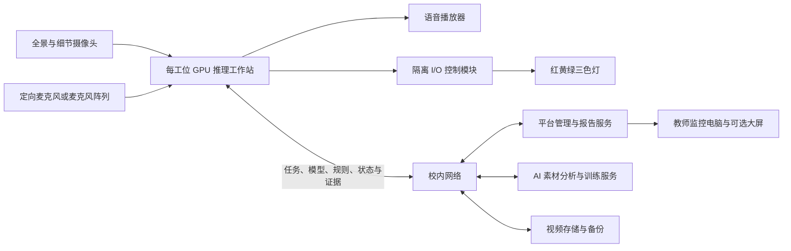

# AI 视觉认知与实训智能评测平台——硬件配置清单（工位推理版）

> 日期：2026-09-14。依据本轮新增要求：每个实训工位配置一台带独立 GPU 的电脑，承担实时 AI 推理与过程评价。以下数量与规格为工程配置建议，不是已完成的性能验证或最终采购数量。

## 1. 部署分工

采用“工位端实时推理 + 校内集中训练、管理与存储”的结构。

- 工位端：接入摄像头和麦克风，运行已发布的识别模型、语音处理和 SOP 评价逻辑，控制语音播放器及三色灯，提供本地录像缓存。
- 校内中心端：管理账号、标准、练习与考试，分析示范素材并训练模型，将锁定版本的模型和规则下发到工位，集中接收评价事件、管理视频证据和报告。
- 教师端：查看各工位状态、视频、评分与异常，执行复核、发布和导出。

本次调整把实时推理由原 PRD 的中心侧移至工位侧。中心训练和集中存储仍保留；模型/规则下发、边端日志同步、版本一致性、联网中断后的处理都需要相应的软件适配。不能因增加电脑就默认已有软件具备离线运行或断网续传能力。

【假设】沿用既有学生语音操作方式，工位电脑主要在后台运行，显示器用于安装、维护及授权操作。

【风险】若允许学生直接使用显示器或电脑桌面，需要增加考试界面与操作权限设计，避免显示实时答案、扣分提示或允许退出评价程序。

## 2. 每个学生工位配置

| 编号  | 设备                | 建议数量/工位      | 必要性        | 用途与选型说明                                                                 |
| --- | ----------------- | ------------ | ---------- | ----------------------------------------------------------------------- |
| H01 | AI 边缘推理工作站        | 1 台          | 必需，用户本轮明确  | 本工位视频解码、动作/工具/零件识别、语音处理、规则评价与缓存。选带独立显卡、可维护散热和足够扩展接口的工作站。                |
| H02 | 全景采集摄像头           | 1 台          | 必需         | 记录工位整体、学生位置、安全防护与操作上下文。根据实际距离核查人脸是否足够清晰，不能默认全景必然可做人脸识别。                 |
| H03 | 操作细节摄像头           | 1 台，按任务可增加   | 建议作为高配标配   | 对准手部、工具、零件和操作区域，补足全景画面细节。建议以“全景 + 细节”双视角起步，数量不等于识别能力保证。                 |
| H04 | 独立身份采集摄像头         | 0—1 台        | 条件选配       | 全景视角无法清楚采集人脸时增加，面向入场位置；若原摄像头满足要求，不重复采购。                                 |
| H05 | 定向麦克风或麦克风阵列       | 1 套          | 必需         | 采集本工位开始、提交、继续等固定指令。建议支持噪声抑制、回声消除等处理配合，安装位置靠近说话区域；跨工位语音归属需现场验证。          |
| H06 | 语音播放器/有源音箱        | 1 套          | 必需         | 播报练习错误、提交漏项询问、安全告警和运行提示；由工位电脑直接播放语音。可与麦克风组合为一体化音频设备，但需核对啸叫、回声与音量覆盖。     |
| H07 | 红黄绿三色状态灯          | 1 套          | 必需         | 红：严重违规/影响评价的故障；黄：等待、暂停、待复位；绿：正常操作。安装位置应便于学生与教师观察。                       |
| H08 | 隔离数字 I/O 或继电器控制模块 | 1 套，或由灯具集成   | 必需功能       | 将软件指令转为三色灯控制信号，可选 USB/以太网/RS485 接口方案；灯、电源和输出电压匹配。使用可直接控制的网络灯时可集成，不重复配置。 |
| H09 | 稳定补光灯及柔光附件        | 通常 1—2 组     | 按现场配置，建议预留 | 改善手部与金属零件区域的照明，控制阴影、反光和闪烁。按实际快门、距离和场景决定，不预设照明功率。                        |
| H10 | 固定支架/人工可调台架       | 1 套，按镜头数配安装点 | 必需         | 固定机位、镜头角度和走线；课前允许人工调整，实训时固定。不配置自动升降、自动转向电机。                             |
| H11 | 摄像头供电与控制电源        | 1 套，按接口核算    | 必需         | PoE 摄像头采用 PoE 交换机或供电器；USB 摄像头核对总线供电与线长；三色灯、I/O、补光灯配置匹配的电源和保护。           |
| H12 | 工位 UPS 或集中 UPS 支路 | 按供电方案        | 建议         | 为电脑、采集与控制设备提供短时供电保护，支持保存记录及有序停机；容量按整工位实际功耗与所需续航核算。                      |
| H13 | 防尘保护机柜/主机支架       | 1 套          | 建议         | 防止主机受碰撞、积尘或不当操作；必须兼顾进出风、散热与维护，不把普通电脑放入密闭箱体。                             |
| H14 | 维护显示器与键鼠          | 0—1 套        | 选配/可共享     | 用于安装、调试、维修与授权操作；学生仍可使用语音完成流程。是否每工位固定配屏，可按现场管理要求决定。                      |
| H15 | 工位线材、线槽与标识        | 1 套          | 必需         | 网线/USB线、供电线、支架连接件、固定件、端口和工位标识。长距离采集不能简单用普通延长线替代合适传输方案。                  |

## 3. 工位推理工作站建议配置

以下为高配方案的选型起点。模型、输入路数及帧率确定后应以实测结果定型，不能只凭显存或某个 TOPS 数字保证时延。

| 部件    | 建议配置起点                   | 说明                                             |
| ----- | ------------------------ | ---------------------------------------------- |
| CPU   | 4核级或以上桌面处理器              | 同时承担流处理、预处理、业务服务和后台任务；最终型号按线程负载和兼容性确定。         |
| GPU   | 单卡 24GB 级或以上独立显存的专业显卡    | 用于视频识别与本地语音等任务。GPU 架构、视频解码能力、推理框架及驱动兼容性同样需要确认。 |
| 内存    | 32GB，支持扩展                | 为多路输入、预处理、模型载入和应用运行留余量。                        |
| 本地磁盘  | 2TB NVMe SSD，按连续写入量选耐久度  | 系统、模型、日志和录像临时缓存；不能替代校内长期集中存储。缓存容量须按码率和保留时长核算。  |
| 网络    | 千兆或 2.5GbE 有线接入；按流量与布线选择 | 工位实时推理不代表录像不用上传，集中录像和模型分发仍占用网络。                |
| 接口    | 满足实际摄像头、音频与控制模块的独立接口需求   | USB 摄像头需要核查控制器带宽；IP 摄像头需要核查网络与供电；不要只数接口数量。     |
| 电源与散热 | 按整机峰值负载匹配，保留扩展余量         | 不统一写死电源瓦数；考虑长时间负载、环境温度及清洁维护。                   |
| 系统    | 按推理框架、摄像头和控制模块驱动统一验证     | Windows/Linux 的选择依赖软件适配，不默认两种系统都支持。            |

GPU 档位参考：NVIDIA RTX PRO 4000 Blackwell 官方规格为 24GB GDDR7 ECC 显存，可作为 24GB 专业工作站显卡的参考之一。该举例不限定采购品牌型号，也不代表该卡已完成本系统负载测试。[NVIDIA 官方规格](https://www.nvidia.com/en-us/products/workstations/professional-desktop-gpus/rtx-pro-4000/)

## 4. 校内共享设备

| 编号  | 设备                | 建议数量            | 是否需要          | 用途与实施说明                                                               |
| --- | ----------------- | --------------- | ------------- | --------------------------------------------------------------------- |
| C01 | 平台管理服务器           | 1 套或复用符合条件的现有资源 | 必需功能          | 账号、SOP、练习考试、任务下发、模型版本、成绩、报告与日志等集中管理。可按规模与其他服务合并部署。                    |
| C02 | AI 素材分析与训练服务器/工作站 | 1 套起，按任务规模评估    | 本地自主训练需要      | 执行上传示范分析、模型训练与更新；避免长时间训练占用正在评价的工位电脑。GPU 显存依据实际模型及训练方式估算，不直接沿用推理工作站配置。 |
| C03 | 视频接入与集中存储服务器/NAS  | 1 套起            | 必需            | 集中录像、证据片段、报告和相关素材；核对并发写入、回放读取和软件文件访问接口。根据需要将接入计算与存储拆分。                |
| C04 | 独立备份设备/NAS        | 1 套起            | 建议配置，满足已有备份要求 | 备份标准、数据库、模型与媒体。RAID 不能代替独立备份；优先复用符合要求的学校备份体系，避免与主存储同机同故障域。            |
| C05 | 教师监控电脑            | 每名同时使用的教师 1 台   | 必需            | 查看多工位视频、操作控制、报告与复核。重点核查多路视频解码和显示能力，不必机械复制每工位的训练/推理显卡规格。               |
| C06 | 教师显示器/监控大屏        | 按实训室            | 教师显示器必需，大屏选配  | 展示工位总览、异常和教学复盘；考试实时扣分不应向正在考试学生公开展示。                                   |
| C07 | 管理型交换机及 PoE 供电设备  | 按端口、功率与流量       | 必需            | 连接工位、IP 摄像头和服务器；建议评估千兆/2.5G 接入与万兆汇聚，不能因采用边缘推理就忽略视频上行带宽。               |
| C08 | 校内路由、防火墙与网络隔离设施   | 按现有网络           | 可复用           | 接入控制、网络分区和受控管理，避免设备与管理接口无范围暴露。                                        |
| C09 | 中心 UPS、机柜、配电与散热   | 按机房负载           | 按现场必需配套       | 保护服务器、交换机和存储；核对功耗、续航、配电、机柜空间与散热能力。                                    |
| C10 | 布线与安装辅材           | 1 项，按现场         | 必需            | 网线/光纤、配线架、线槽、标识、配电附件与安装调试。应纳入预算，避免只采购主机和摄像头。                          |
| C11 | 标准示范采集套件          | 1 套或复用工位设备      | 可复用           | 教师拍摄训练素材时使用摄像头、支架和补光；已有工位能满足时不重复采购。                                   |

平台管理、训练和视频接入是三个职责，不意味着必须采购三台独立计算服务器。可按负载合并或拆分，但备份设备应具备独立保护价值，训练资源不能挤占实时业务。

## 5. 摄像头与采集接口注意事项

- 工位基础建议为一个全景视角和一个操作细节视角；是否增加身份或辅助相机由实际画面决定。
- 优先确定距离、视野、最小需识别细节、运动速度与光照，再确定分辨率、镜头和帧率；不能只写“高清摄像头”。
- 高速手部动作需同时考虑曝光时间与照明。全局快门有利于避免快速运动的几何畸变，但不能自动消除曝光过长造成的运动模糊。[Axis 全局快门与滚动快门说明](https://whitepapers.axis.com/en-us/global-shutter-vs-rolling-shutter)
- IP 摄像头应核对平台支持的取流协议和实际编码组合。ONVIF Profile T 涵盖 H.264/H.265 等视频流能力，但并不表示所有附加功能都可无条件互通，需要联调。[ONVIF Profile T 官方说明](https://www.onvif.org/profiles/profile-t/)
- USB/工业相机优先核对驱动、SDK、USB控制器带宽、线缆距离和多相机同步需求；若选择 HDMI/SDI 输出的相机，则按接口另配采集卡，不为所有相机重复采购采集卡。
- 三色灯需要可控接口和匹配电源；普通电脑不能直接用网口或 USB 电源线去驱动任意工业灯具。数字 I/O、继电器或集成网络控制器是常被漏列的部分。
- 语音输入与播放需联调回声和跨工位串音。仅购买标称降噪麦克风不能证明已经实现“只接受本工位学生指令”。

## 6. 数量汇总口径

设学生工位数为 N、同时使用教师数为 T，建议高配基础组合为：

- AI 工位推理工作站：N 台。
- 全景摄像头：N 台；操作细节摄像头：N 台；身份/额外辅助摄像头按画面需要配置。
- 麦克风：N 套；语音播放器：N 套；三色灯：N 套。
- 灯光控制功能及配套电源：N 套，可由灯具集成。
- 补光、固定支架、防护、线材：按 N 个工位配套。
- 教师监控电脑：T 台。
- 中心管理与训练计算资源、视频存储、独立备份、网络和供电：按全室容量配置，不与 N 简单等倍。

最终报价前需要确定 N、T、每工位摄像头数量、运行时段、视频码率与保存期限、模型与语音负载，再核算服务器、存储、交换机、UPS和电力配套。

## 7. 非基础必配的增强设备

电子扭矩工具、可读数仪表、设备数据采集模块等可以在未来用于直接获取工艺数值，但需要新增数据接入与评分适配，未纳入当前视觉评价方案。当前对视觉不能确认的扭矩等要求，仍遵循人工复核规则。

相机自动运动机构、学生触摸屏、AI 控制实训设备急停/断电均不是本期既定能力，不因硬件清单扩充而自动包含。设备自身原有安全保护按实训设备配置执行。
