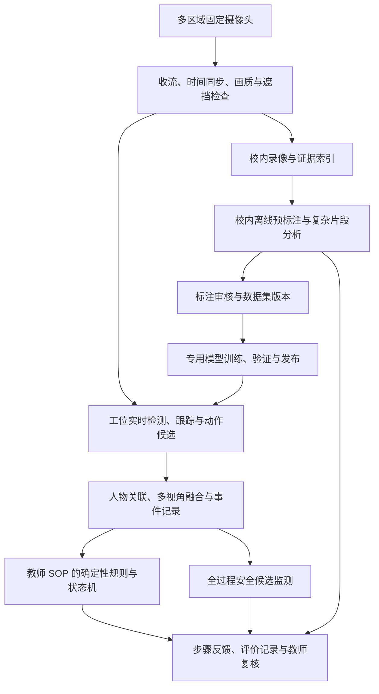

# VLX 模型与大场景 SOP 实训可行性分析

日期：2026-10-15。分析对象：兴辰智能 AI 视觉实训操作流程智能评测系统。

落地口径补充（同日）：后续对照现有一期重构文件，确认SOP已发布后修改采用“复制创建”，不新增用户可见SOP/配置/数据集/模型版本体系。下文的版本追溯在实施中对应内部任务记录与锁定快照；预标注审核采用标注页内人工检查并保存，不新增已标注后的独立审批。具体以[后续原型改造方案](后续行动方案-2026-10-15/02-产品原型改造方案.md)为准。

本次依据官方仓库、模型卡、论文和当前原型代码进行分析，尚未在现场运行这些模型。文中区分公开事实、项目现状、工程判断与建议验收目标。用户已同意按以下条件分析：单名主操作人、允许增加固定摄像头、核心业务校内运行。单名学生并不排除教师、同学短时进入画面。

## 1. 核心结论

**这些模型对项目有帮助，最值得优先验证的是 VLX-Seek 的物体预标注与复杂目标定位；VLX-VR 适合探索课后证据检索和动作片段预定位；VLX-Flow 的技术方向适合持续视频理解，但目前不能将公开可本地部署能力视为已经具备；VLX-Go 与当前固定摄像头实训评价任务不匹配。**

大场景可以做成“多区域、多视角、证据驱动的过程辅助评价”，但当前材料不能支持“用现有双摄像头和一个通用视频模型，完整自动评价高压换电池全过程”的承诺。关键制约依次是：关键动作是否拍得到、细节是否看得清、行为是否属于当前学生、证据是否足以支持业务结论、模型与规则是否经过独立现场验证。

当前产品的标准管理、能力配置、证据回放、教师复核、版本锁定与降级逻辑有复用价值。需要扩展的主要是感知与证据层、摄像头配置方式、持续状态和跨区域事件处理，而不是推翻整个教学与评价流程。

建议实施顺序：**先核查现场可见性 → 做物体预标注试验 → 验证几个高价值可见事件 → 扩展多区域过程 → 最后评估复杂语义模型是否值得上线。** 不建议四个模型一起接入后再判断效果。

## 2. 四个模型究竟能做什么、现在能否使用

以下发布状态以本次查阅的官方资料为准，未来可能变化。公开代码、公开权重、在线体验和可校内生产部署是不同条件。

| 模型 | 官方定位与当前可核实交付 | 对本项目的建议 | 不应据此作出的承诺 |
| --- | --- | --- | --- |
| VLX-Seek | 细粒度视觉定位与区域引用；Seek 1.5-10B 已公开权重和推理代码。0.6B、3B 属于官方描述的家族规划，本次未核实到对应已发布权重 | 优先做校内离线预标注、难目标定位与区域语义核查试验 | 不能把模型家族规划当作现成小模型；不能直接宣称支持多摄像头实时 SOP 自动评分 |
| VLX-Flow | 流式视频理解，增量更新视觉缓存与语义记忆；官方仓库仍注明 checkpoints coming soon | 保留流式语义接口；通过可获得的服务做研究性试验前，先核实服务条件 | 不能当作已经拿到可离线部署的模型；没有依据保证现有工位 GPU 的多路实时性能 |
| VLX-VR | 通过证据获取与记忆循环进行视频推理；公开论文、案例和 API cookbook，仓库定位为 SDK 使用材料 | 条件允许时试验课后片段定位、异常线索检索、报告草稿；若严格不出校，先核实私有化交付 | 不能将论文/SDK 开源等同于权重已公开；不能直接承担低延迟安全判断 |
| VLX-Go | 0.6B 机器人短时航点规划，输出机器人后续移动目标；官方权重与数据集仍标注 coming soon | 本期不采用。未来若加入移动巡检机器人，另做导航项目评估 | 不能因支持目标跟随就把它当作学生环车轨迹评价模型 |

依据：[Seek 官方仓库](https://github.com/om-ai-lab/VLX-Seek)、[Seek 模型卡](https://huggingface.co/omlab/VLX-Seek-1.5-10B)、[Flow 官方仓库](https://github.com/om-ai-lab/VLX-Flow)、[VR 官方仓库](https://github.com/om-ai-lab/VLX-VR)、[Go 官方说明](https://github.com/om-ai-lab/VLX-Go)。

### 2.1 Seek 的价值及限制

Seek 不是仅靠语言生成几个坐标。它从候选区域中检索并引用符合描述的目标。因此它适合试验“找出钥匙、锥桶、验电工具”“定位当前学生附近的特定物件”等任务。这里的项目适用性是工程推断，尚无本项目实测结果。

重要限制是候选框召回率：如果前置区域生成器没有把小验电笔或被遮挡的手套找出来，后面的语言理解不能保证补救。官方公开方案用 WeDetect 替代内部未公开的 OPN，也允许外部传入候选框；不能默认公开方案与内部展示使用同一前端。官方模型卡也明确列出遮挡、模糊、低分辨率和候选区域不足等限制。[官方模型卡](https://huggingface.co/omlab/VLX-Seek-1.5-10B)、[官方候选区域说明](https://github.com/om-ai-lab/VLX-Seek#model-weights)。

所以要测完整管线：候选区域生成、Seek 筛选、坐标还原、重复框处理和类别映射。只测试“模型能否说出图里有手套”没有验收意义。公开 worker 提供区域框结果，其批量接口按请求串行执行；不能把接口名称中的 batch 理解成已经实现高吞吐并行服务。[官方 worker](https://github.com/om-ai-lab/VLX-Seek/blob/main/vlx_seek_worker.py)。

### 2.2 Flow 与 VR 的业务分工

Flow 的研究方向对应“视频持续进入，系统保持当前环境的理解”；VR 对应“围绕问题回看录像，查找并核对证据”。前者可能减少重复处理历史视频，后者可能减少教师寻找相关片段的时间。二者都不应代替可持久保存、可审计的 Session 事件记录和确定性 SOP 规则。

VR 官方 cookbook 明确适用于允许等待的视频文件分析，并要求传入服务可访问的视频 URL；这会影响“录像全部留在校内”的条件。Notebook 能运行 API 请求，不证明该模型可在校内离线运行。当前严格校内方案应将 VR 列为条件性候选，先取得可验证的私有化方案，或选择可本地运行的替代视频模型。[VR 官方 cookbook](https://github.com/om-ai-lab/VLX-VR/blob/main/notebooks/vlx_vr.ipynb)。

### 2.3 如何理解网上的性能数字

VR 论文报告 MINERVA 上 78.79% 的结果，对应视频问题的多选题正确率；96.20% 对应“已经答对样本”中的推理轨迹与参考证据一致性。二者都不是本项目的安全检测准确率、漏项召回率或自动标注可用率。论文也指出计数、状态变化等任务仍有不足。[VR 论文](https://arxiv.org/html/2609.09985v1)。

因此，外部基准可用于决定是否值得试验，不能用来写本项目采购与验收承诺。本次也没有核实到这四个模型在新能源汽车高压实训、同一学生跨多个固定摄像头的全过程评价上的独立验证。

生产使用还要分别确认代码、权重、候选框模型和基础模型的许可，以及在线服务的数据与费用条款。Seek 仓库标注 Apache-2.0，不能据此推断所有外部组件和服务都使用同一许可。公开推理代码也不等于已提供适合本项目的一键微调、量化、导出和部署流程；首期可以用审核后的预标注训练现有专用模型，不必先微调整个 Seek。

## 3. 当前项目已经有哪些基础

本次以当前原型代码和 `currentPrototypeData.json` 为现状依据；历史 PRD 和硬件清单用来解释架构意图，不覆盖当前已确认规则。

### 3.1 可保留的产品逻辑

1. 教师拥有并发布 SOP，模型不生成或修改教学标准。
2. 可复用 AI 能力与具体 SOP 分离，通过判断项、逻辑区域和规则映射关联。
3. 支持目标检测和动作识别，判断条件可组合为全部满足、任一满足或按顺序满足。
4. 工位上线前有配置检查和现场验证；SOP、模型、ROI、相机配置与 Session 锁定。
5. AI 自动、AI 辅助、教师评价三种模式共存。
6. AI 不确定、证据缺失和系统故障不直接扣学生分；教师改判保留理由与审计。
7. 安全候选与普通评分分开处理，确认安全红线需要暂停/处置。
8. 原始素材、抽帧/切片、清洗、标注、数据划分、训练、发布形成了产品流程。

这些基础适合接入新模型。模型提供观察事实或候选片段，现有业务层决定如何影响步骤、反馈、评分和教师注意事项。

### 3.2 当前演示与真实算法实现的边界

| 代码证据 | 当前实际含义 | 对可行性判断的影响 |
| --- | --- | --- |
| `aiModelTrainingRules.js` 的 `resultFor()` | 精确率、召回率、动作准确率等由固定数值生成 | 页面指标不能作为真实模型验证结果 |
| `aiRuntimeRules.js` 的 `simulateAiConditionOnSession()` | 通过模拟条件产生观察；持续时间取配置值 | 已演示规则流转，尚未验证视觉观察质量与实际计时 |
| `startAiRuntimeSession()` | 开始时生成 `track-${session.id}` | 有主操作人绑定概念，但该 ID 不是跨镜头跟踪算法输出 |
| `sopWorkstationAiRules.js` | 可用相机限定为主相机与备用相机，判断项绑定单个 `cameraId` | 需要扩展真正的相机集合和多视角证据融合 |
| `aiAnnotationRules.js` | 物体框、无目标标记、动作类别和起止时间的人工保存 | 有适合接入预标注的落点，尚缺建议审核生命周期 |
| `aiExtractionRules.js` | 时间间隔抽帧、按帧率抽帧、手动或定长切片 | 尚需增加事件驱动选帧和动作候选片段 |
| `aiTrainingDataRules.js` | 按原始视频分组划分训练/验证/测试 | 已避免同一原始视频帧直接混入多个集合；多相机同步录像还应按同一 Session 统一分组 |
| `worker/index.js` 与依赖清单 | 静态资产服务与 React 原型 | 本次未见真实视频推理后端、模型训练服务或跨镜头融合服务 |

例如，当前数据快照的“新能源汽车高压系统下电与验电综合实训”含八步，其中防护检查配置为自动评价、车辆下电为辅助评价，其余多数步骤为教师评价。它并不是已经全部自动识别的高压换电池方案。

代码入口：[运行规则](</Users/chenxuguang/Documents/ChatGPT/AI SOP 实训评价/xingchen-prototype/src/aiRuntimeRules.js:750>)、[训练结果模拟](</Users/chenxuguang/Documents/ChatGPT/AI SOP 实训评价/xingchen-prototype/src/aiModelTrainingRules.js:225>)、[工位相机配置](</Users/chenxuguang/Documents/ChatGPT/AI SOP 实训评价/xingchen-prototype/src/sopWorkstationAiRules.js:152>)、[当前数据快照](</Users/chenxuguang/Documents/ChatGPT/AI SOP 实训评价/xingchen-prototype/src/data/currentPrototypeData.json>)。

## 4. 大场景的真正难点：观察到动作与证明完成要求

需要把每条 SOP 拆成四层：

| 层次 | 示例 | 所需证据 |
| --- | --- | --- |
| 物体存在 | 画面中有两只手套 | 目标框与可见性 |
| 人物关系/动作 | 当前学生双手佩戴手套 | 人、左右手、手套之间的关联与连续画面 |
| 过程完成 | 按要求完成各检查点 | 检查点、动作、顺序、时间与对象的证据链 |
| 工艺/安全结果 | 绝缘合格、已安全下电、扭矩合格 | 有效测试结果或教师专业判断；外观通常不足以证明 |

前两层在可控拍摄条件下有较好的试验价值；第三层需要业务事件与时序规则；第四层不能普遍靠普通摄像头确认。扩大模型只能改善对已拍摄信息的理解，不能生成被遮挡区域的真实证据。

## 5. 按高压换电池场景逐项分析

以下为建议的可评价性划分，不是修改教师正式 SOP，也不是专业高压操作规程。具体检查点与顺序仍由课程教师确定。

| 场景 | 适合尝试自动获取的事实 | 可考虑的技术组合 | 必须保留的边界与常见误判 |
| --- | --- | --- | --- |
| 工作台上佩戴绝缘手套 | 主操作人、左右手可见、两手佩戴状态、持续时长 | 手套/人/手部检测、人物关联、近景视频；Seek 用于预标注与疑难区域 | 桌上两只手套不能证明已佩戴；普通手套不能靠相似外观证明绝缘性能；需防拿着、单手、借别人的手等误判 |
| 在工位前摆放锥桶 | 指定入口区域的锥桶数量与位置；放置前后变化；是否持续保留 | 检测、区域规则、目标跟踪；Seek 预标注 | 区分“已有人摆好”与“该学生亲自摆放”；临时拿进 ROI 不能代表已布置；不应只靠一次出现事件永久判定隔离有效 |
| 环车检查一圈 | 同一学生经过教师定义的车周区域；各检查点停留与可见动作候选 | 人体跟踪、跨镜头关联、相机标定、区域轨迹；视频模型辅助检索 | 走了一圈不等于完成检查；低头、停留也不等于检查到具体部件。先声明系统验证的是轨迹还是具体检查动作 |
| 进入驾驶舱操作 | 上车、入座、操作部位可见、钥匙位置/可见指示变化 | 舱内固定视角、局部检测/动作识别、必要时 OCR 候选 | 外部全景不能看清按钮、钥匙与仪表；“按了按钮”不能直接证明车辆状态。OCR 读数也需验证单位、量程及读数归属 |
| 钻进车底查看底盘 | 同一学生进入车底区域、姿态变化、特定部位的检查动作候选 | 车底专用机位与补光、部位定位、片段动作识别 | 外部摄像头最多确认“进入车底”；停留不能证明底盘检查完成；工具、车身和肢体遮挡会破坏证据 |
| 验电工具自检与 A/B 点验电 | 工具识别、端点区域、接近/可见接触候选、次序、持续时间 | 细节镜头、目标/动作模型、业务时序规则 | 工具在端点附近不代表电气接触有效；工具移动动作不代表验电成功；实际读数与安全结论保持教师判断 |
| 电池拆装、接插件与绝缘防护 | 指定工具、拆装动作候选、防护帽出现与可见安装状态 | 局部检测、动作片段、近景证据 | 隐蔽锁止、内部连接、实际扭矩和电气结果通常无法靠画面充分确认 |
| 全过程安全防护 | 当前学生在相关作业区域的防护状态；锥桶是否移除等持续变化 | 独立于当前步骤的持续监测与证据队列 | 手套开始时戴好不代表一直戴着；未知状态不直接扣分，也不能显示成 AI 已确认安全 |

**最先值得自动化的通常是：警示物摆放、人员进入区域、可见防护状态、指定工具使用候选和证据片段整理。最不宜承诺纯视觉自动确认的是：隐蔽工艺质量、电气安全状态和完整检查质量。**

## 6. 摄像头与工位如何扩展

### 6.1 把工位理解为一个实训单元

“一台 GPU 对应一个工位”的管理关系可以保留，但汽车实训中的一个工位应包括工作台、入口、车周、驾驶舱、车底等多个观测区域。它不等于一个固定桌面画面。

建议建立“实训单元 → 区域 → 相机视角 → 可获取的证据 → SOP 判断项”映射。相机具有角色，例如工作台细节、车周轨迹、舱内操作、车底局部；备用相机和同时取证的辅助相机要分开表达。

### 6.2 机位探索方案

可以用下列方案开展现场勘察与试拍：工作台近景一个、入口及车辆外部若干互补视角、驾驶舱一个、车底一个或多个。粗略可能形成 5—7 个视角，但这仅是试拍假设，不是采购数量。真实数量取决于车辆、举升状态、机位遮挡、检查点及镜头覆盖；已有视角若满足多个任务可复用。

要验证的是每条关键证据能否在正常学生姿态下被至少一个镜头看清，以及必要的跨视角交接区是否存在。外观全景、鱼眼全景和“4K”本身都不保证手部或工具细节可识别。

小目标像素可以做初步估算。例如，某画面水平覆盖 8 米、水平分辨率 3840 像素时，横向 2 厘米细节理想情况下只有约 9.6 像素，尚未考虑透视、缩放和压缩。把画面显示成高清并不会补回丢失细节。这是几何示例，不是某模型的最低像素门槛。

各路时间戳要统一；相机移动、车辆位置变化、分辨率和镜头参数变化应使受影响的区域配置进入重新验证。地面轨迹可以使用平面标定，不能把地面的同一转换直接用于驾驶舱手部或车底部件。

相机与支架安装需要适应实训现场的维护、照明及空间条件。保持当前固定机位原则，暂不引入自动追拍机构或移动机器人。

## 7. 建议的技术架构

保留当前“工位端实时推理 + 校内集中训练、管理与存储”的路线。新的模型应通过可替换接口接入，训练与离线重模型分析不占用实时评价资源。

### 7.1 三种处理速度

| 路径 | 适合任务 | 新模型的角色 |
| --- | --- | --- |
| 工位实时路径 | 人/工具/防护物检测、跟踪、状态变化、短动作候选 | 已验证的专用模型优先；Seek 是否适合必须测实际时延与资源 |
| 按需语义路径 | 疑难对象核查、复杂可见关系与动作线索 | Seek 或本地视频模型作为候选解释器；Flow 获得可用交付后再评估 |
| 校内离线路径 | 预标注、候选片段定位、报告与教师检索 | Seek 优先；VR 在交付与数据条件满足时试验 |

这三个路径共享可追溯事件与录像，但权限和用途不同。离线报告不得悄悄覆盖已经发布的成绩。

### 7.2 统一观察事实

建议事件至少包含：Session、主操作人、局部 track 与关联状态、相机与区域、观察对象/动作、起止时间、可见性、候选框或片段引用、模型与配置版本，以及确认/不确定状态。步骤映射由业务规则执行，避免模型因为已知“当前该做哪一步”就把相似动作解释为该步骤。

若使用置信信息，应说明来自检测器、分类器、规则融合还是人工确认，并经过本地验证。自然语言模型自行声称“置信度 0.98”不等于经过校准的错误概率；Seek 的区域结果也不能直接套用成统一分类置信度。

对人物轨迹短时丢失采用显式未知状态，不能仅按“最近的人”把另一个人的动作归给学生。允许通过交接区域、时空条件、外观特征和教师重新确认恢复绑定；同款校服、手套和遮脸时需专门测试。

### 7.3 观测层、教学步骤与安全监测分开

当前模拟入口只接收当前步骤的条件。真实系统应持续记录全部相关观察，再由教师定义的时间窗口决定哪些事件有效。这样可以发现提前做、错序做、重复做和纠正动作，而不是因步骤尚未开放就丢弃原始事实。

手套、警示隔离和危险区进入等持续条件应有独立监测，不能完成 Step 01 后停止观察。持久状态要有更新、失效和未知规则；一次出现不永久代表当前状态。

## 8. 自动标注如何减少人工

### 8.1 应区分四种标注

| 标注任务 | 可采取方式 | 预计价值与边界 |
| --- | --- | --- |
| 物体类别与目标框 | Seek 或开放词汇检测生成预标注；人工修正 | 优先试验。价值取决于召回、框质量与类别歧义 |
| 连续帧物体轨迹/区域 | 关键帧人工校正后，通过跟踪/分割传播 | 减少逐帧重复绘制；遮挡和新目标出现后需重新检测或校正 |
| 动作片段及类别 | 视频模型建议时间范围与动作标签；人工微调起止点 | 能减少拖动长录像的时间，不能保证动作边界准确 |
| SOP 合格性与评分标签 | 模型给证据候选，教师按固定标准判定 | 专业结论与真实测量不宜全自动生成金标准 |

如果目标是快速节省物体标注，应该同时比较 Seek 和 Grounding DINO/SAM 2 等既有管线，而不是预设新模型一定更省人。Grounded-SAM-2 官方项目已有文本定位、图像自动标注及视频目标传播示例，适合作为对照方案。[Grounded-SAM-2 官方仓库](https://github.com/IDEA-Research/Grounded-SAM-2)、[SAM 2 官方仓库](https://github.com/facebookresearch/sam2)。

SAM 2 传播的是对象区域，不能据此认定“验电动作完成”或“环车检查合格”。单视角连续 ID 也不自动等于跨镜头身份重识别。

### 8.2 融入现有数据流程

建议扩展现有流程为：

**原始录像 → 质量检查与选帧/候选切片 → 人工保留 → AI 预标注 → 人工审核与纠错 → 锁定数据集 → 专用模型训练 → 独立测试 → 发布与现场验证。**

保留现有“人工清洗已保留”条件，在标注页增加预标注服务。后续若要将自动清洗直接送审，应作为单独功能决策，不在本次分析中悄悄改变现有门禁。

建议的标注状态：待预标注、处理中、待审核、已审核、退回修改、任务失败。AI 建议不能直接写成当前 `annotationStatus=completed`；可以单独保存建议，再由审核动作生成正式标注。

保存模型/提示版本、类别词表版本、来源帧与时间段、AI 原始建议、人工最终结果、审核人和修改记录。支持重试、取消、批量接受与撤销，但批量接受的类别和质量条件需要先做验证。

优先展示疑难数据：预标注与专用模型不一致、目标太小、遮挡严重、人物不明、背景误检、无目标建议、动作边界不明确。对“无目标”建议尤其要防漏标；模型没找到不代表真实不存在。

### 8.3 必须增加的负例

手套应有桌上、手持、单手、普通相似手套、别人的手套；锥桶应有已摆放、只路过、摆错区域、放好又移走；动作应有拿着工具站立、靠近但未操作、操作中断、错误后重做等。

保留 Other/背景/非目标动作和不确定状态，不强制每段录像都属于某一个 SOP 动作。自动标签不能扩展或重写教师 SOP。

### 8.4 如何测节省了多少

目前不能负责任地给出“减少 80% 人工”一类结果，应做对照计时。

`节省比例 = 1 - (预标注任务管理 + 人工审核 + 纠错补标 + 质量抽检的人时) / 纯人工标注人时`

机器 GPU 时间与费用另列；有人必须等待机器完成的时间计入人员占用。比较必须达到同一金标准质量，分别统计目标框、动作片段和 SOP 结论。

例如，仅作预算理解：纯人工每张 60 秒，预标注后的审核、修改、抽检和任务管理合计每张 30 秒，才对应人工减少 50%。这是演算示例，不是模型效果。若大量漏框使每张返工 70 秒，预标注反而增加工作。

先由专家独立标注一部分测试集，再对其余数据预标注。不要让同一个模型的自动标签同时成为自身效果的参考答案。

## 9. 现有原型最值得调整的八个位置

本节为后续改造建议，本次未修改原型功能。

| 优先级 | 调整位置 | 建议 | 业务价值 |
| --- | --- | --- | --- |
| P0 | 工位及相机配置 | 主/备用结构扩展为相机集合，区分备用与同时工作的辅助相机；支持区域角色和视角覆盖 | 能表达车辆大场景 |
| P0 | 判断项与证据要求 | 一项允许引用多个视角；定义是否同一人/对象、组合顺序、所需可见性、时长及证据 | 避免“找到两个物体”误作“完成操作” |
| P0 | 运行状态 | 增加跨区域人物关联、轨迹丢失、视角不足与恢复记录 | 避免错人归属 |
| P0 | 评分与结果显示 | 评分政策与 AI 判定状态分开，默认保分不写为“AI 已确认正确” | 防止满分掩盖大量未判定 |
| P0 | 全程事件与安全监测 | 记录非当前步骤观察，持续检查必要状态 | 支持错序与防护状态变化 |
| P1 | 标注页 | 增加 AI 预标注、审核、纠错、建议版本与批量处理 | 减少手工重复劳动 |
| P1 | 能力模型发布 | 支持自训练模型、可用基础模型和模型服务的不同交付方式；验证后才开放 | 不必每新增一个对象就强制先训练完整模型 |
| P1 | 现场验证与报告 | 按具体步骤、场景分布、摄像头集合统计覆盖与错误；证据时间轴支持多视角 | 把演示门禁升级为真实上线证据 |

业务界面不必直接向教师罗列全部算法细节。教师关注哪些标准能自动判断、证据是否齐全、哪些记录需要复核；模型、ROI、参数、资源诊断仍放管理员/实施界面。

### 9.1 “默认满分”需要增加独立结果口径

沿用已确认规则：不可判定不自动扣分，不新增对成绩发布的阻塞。与此同时分别显示：

- AI 证据支持完成；
- AI 不确定/画面不足，按规则保分；
- 该项设计为教师评价，按规则保分或人工改判；
- 教师已确认；
- 安全候选待处置/安全红线已确认。

“未判定”与“已确认完成”不能合并。教学步骤推进可以沿用学生提交/教师操作，但应记录推进来源，不能凭默认满分伪造视觉完成证据。

对安全候选，维持现有处置机制；证据不明不能自动扣学生分，也不能推断现场安全。视觉系统的告警与实训设备本身的安全保护具有不同职责。本次不新增传感器、PLC 或设备急停控制。

## 10. 硬件与资源影响

现有清单的 24GB 级 GPU 是选型起点，不能直接证明 Seek 1.5-10B 可与多路检测同时稳定运行。粗略按 10B 参数、每参数 2 字节估算，权重约 20GB（十进制），尚未计入候选区域检测、激活、缓存、视频解码和框架开销。该计算是内存估算，不是实测最低显存或采购推荐。

量化可能减少权重占用，但必须验证模型架构、算子、推理框架的支持及量化后的定位质量，不能假设任意 4bit 方案都可用。官方推理资料也指出加速内核缺失时会回退到较慢实现。[Seek 官方推理说明](https://github.com/om-ai-lab/VLX-Seek/blob/main/docs/inference.md)。

建议先在校内共享 GPU 上跑离线预标注，工位保留轻量实时模型。是否把 Seek 放到每个工位，以完整峰值负载测试决定。校内中心承担离线分析不改变工位实时评价路线；若未来把中心模型纳入实时判定，需要明确架构变更、网络依赖和降级策略。

额外机位会增加收流、解码、上行、录像与存储负载。录像帧率、模型取样帧率、教师预览帧率应分开设计；节省推理不能靠静默丢失重要证据。语义模型按需调用，但基础记录与必要监测持续运行。

用于理解容量的示例：6 路各 4Mbps、每天录像 8 小时，视频净数据约 86.4GB/天/实训单元；20 个单元约 1.73TB/天，保存 30 天约 51.8TB，均未含冗余、备份和额外副本。所有数值是假设下的计算，现场先测实际码率与录像时段，再定预算。

训练与生产资源必须隔离；评估成本应包括 GPU、镜头与安装、存储、推理服务维护、标注审核、模型迭代和现场重新验证，不只比较模型 API 价格。

## 11. 最小可执行验证方案

### 11.1 先验证三个任务

1. **预标注试验**：手套、钥匙、警示物、验电工具。比较纯人工、Seek、既有开放词汇管线，测同质量下的人员耗时。
2. **可见事件试验**：警示物进入并保持在指定区域、当前学生双手佩戴状态、指定工具进入局部区域。验证人物关系与持续状态，不只验证物体存在。
3. **跨区域取证试验**：工作台 → 入口 → 车周 → 驾驶舱 → 车底，先验证轨迹、事件与证据衔接；检查质量另按教师检查点验证。

无需等待 Flow 发布即可开始这三类试验。VR 若尚不满足校内条件，不成为试点阻塞项。

### 11.2 采样与金标准

建议用 6—10 名参与者、跨至少两天、约 40—60 次完整演练作为发现问题的初始样本，具体规模随课程及资源确定。该规模用于试点诊断，不足以单独证明高可靠生产能力。

样本要覆盖不同身高、左右手、衣着、光照、相机距离与自然遮挡，并有教师入镜、短时轨迹丢失、相机断流。加入正常、漏项、错序、错误对象、错误后纠正、不可见、安全模拟等场景。高风险错误使用脱能设备、道具或已有安全模拟素材，不为采样执行危险操作。

特别设置伪完成样本：桌上放两只手套、锥桶一闪而过、完整绕车但不检查、进入驾驶舱但未执行动作、车底停留但未检查、工具靠近端点但没有有效动作。这些比标准示范更能暴露模型是否把场景常识当作事实。

至少两名课程教师分别标注关键测试片段并解决分歧，固定“正确/错误/不可见/不可判定”口径。同一次演练的全部相机录像以及派生图片归入同一数据组；进一步按人、日期或场地留出独立测试集。当前按单个 `sourceVideoId` 分组的基础值得保留，但不足以隔离同一次多相机演练的相关数据。

### 11.3 分别衡量什么

| 对象 | 指标与统计单位 |
| --- | --- |
| 预标注 | 框/类别质量、漏标/误标、动作边界误差；审核后总人时；按任务类型分组 |
| 物体与人物关系 | 目标级精确率/召回率；戴着/拿着/摆着等关系混淆 |
| 动作与过程 | 事件级召回、错误完成次数、错序识别、动作边界误差、纠正识别 |
| 人物归属 | 身份切换与错归属次数、跨镜头交接成功率、失联时能否拒绝归属 |
| 不确定性 | 真正不可见时是否返回未知；有证据却拒判的比例 |
| 教学业务 | 自动评价证据覆盖率、教师复核比例、每 Session 教师实际用时、人工改判率 |
| 实时运行 | 采集到可用事件的总延迟、判定后通知延迟、P95、峰值显存/解码/温度、断流恢复 |
| 安全候选 | 场景级漏报、每小时误报次数与教师处置负担；不得被普通帧级准确率掩盖 |

自动评价证据覆盖率可以定义为：具备可靠自动判定证据的考核项权重 / 全部考核项权重；另外给出自动项内部的可判定率，避免通过缩小自动化范围掩盖低覆盖。

### 11.4 建议的决策门槛

下面是内部试点的讨论起点，不是已经通过的效果或学校正式验收条款：

- 同质量下，预标注总人工时间减少约 30% 或更多，且严重漏标未增加，才扩大使用；若只节省少量时间但维护复杂，可先用简单管线。
- 自动完成候选的误判目标可设为低于 1%，同时考察召回和不可判定比例；遇到视角不足、身份不明时必须正确拒判，不能为了覆盖率强行给结论。
- 不可判定与技术故障不自动扣分，这是一项确定性业务检查，必须全量验证。
- 实时提示需分别测动作观察窗口、模型计算、规则处理与通知，而不是只测模型出字速度。既有“判定后 2 秒内提示”不能替代整个检测延迟要求。
- 安全候选单独评估，不以普通事件平均指标代替；上线范围和阈值由课程负责人依据验证结果决定。

若 100 个相对独立事件中零次错误，按常见的 `3/n` 近似，单侧 95% 置信上界仍约为 3%；300 个零错误才约为 1%。这是统计量级说明，相邻视频帧不能当作独立试验来放大样本数。因此“八种场景各演示一次”可作冒烟验证，不能证明错误率足够低。[零事件概率的统计说明](https://pmc.ncbi.nlm.nih.gov/articles/PMC2550668/)。

## 12. 可落地的产品范围

建议首期对学校明确呈现：

> 在已完成现场验证的可见检查点，系统自动整理人员、工具、防护和动作证据，辅助过程评价；复杂区域与视觉无法可靠确认的工艺结果由教师判断，系统提供可回放证据和操作记录。

教学课程可分为：固定工作台易观测任务、多区域但可明确取证任务、主要依赖教师专业判断的任务。三者都能进入平台，但自动化覆盖与现场交付要求不同，不应共用同一“全自动率”承诺。

对高压换电池，大场景验证前宜先交付防护与警示检查、区域到达、部分可见动作、证据索引和教师复核；环车具体检查、舱内细节与车底部件检查按采集条件逐项开放；实际电气与工艺合格结果保持已有教师判断边界。

## 13. 选型决策表

| 候选 | 现在的决策 | 扩大采用所需条件 |
| --- | --- | --- |
| Seek 1.5-10B | 优先离线试验 | 比基线减少总标注人时或提升难目标定位；完整公开管线通过本地数据验证 |
| Flow | 关注并保留可替换流式接口 | 获得权重/服务交付条件，验证多流、持续运行、中文指令与事件质量 |
| VR | 课后分析条件性试验 | 满足校内数据条件，核实私有化或受许可 API 方案，证据时间戳与事实可靠 |
| Go | 本期不采用 | 确实新增移动机器人导航需求后重新评估 |
| 开放词汇定位 + 视频传播管线 | 作为预标注对照 | 在同一金标准下比较漏标、返工、人时与资源 |
| 训练后的专用检测/动作模型 | 保留为实时基础路线 | 本地独立数据与现场峰值负载验证；不以示范素材的效果代替测试 |

最可能带来的收益是减少重复标注、减少录像查找、提高长尾对象识别和证据整理效率。能否减少实时教师介入取决于整条观察—关联—规则—证据链；模型名称本身不能回答这个问题。

## 14. 证据与未决项

本报告的模型发布状态和公开能力来自上述官方链接，项目事实来自当前源码与数据快照；拍摄方案、架构扩展、优先级和试点门槛是建议。未进行模型下载、现场推理、性能基准、实际费用核算或原型功能修改。

进入采购/研发定稿前需要补充：现场平面与车辆状态、教师具体检查点、真实演练录像、镜头/编码参数、工位 GPU 与驱动、每天录像时长和保存期、同时运行数量、可接受误报与复核工作量，以及相关模型的交付条件。材料补齐后应以试拍和对照验证收敛，不宜先固定全场景识别承诺。

当前项目证据还包括：[原型规则与已确认边界](</Users/chenxuguang/Documents/ChatGPT/AI SOP 实训评价/xingchen-prototype/AGENTS.md>)、[人工标注规则](</Users/chenxuguang/Documents/ChatGPT/AI SOP 实训评价/xingchen-prototype/src/aiAnnotationRules.js>)、[AI 判断项配置](</Users/chenxuguang/Documents/ChatGPT/AI SOP 实训评价/xingchen-prototype/src/aiCapabilityConfigRules.js>)、[训练数据划分](</Users/chenxuguang/Documents/ChatGPT/AI SOP 实训评价/xingchen-prototype/src/aiTrainingDataRules.js>)、[工位推理硬件清单](</Users/chenxuguang/Documents/ChatGPT/AI SOP 实训评价/AI视觉认知与实训智能评测平台_硬件配置清单_工位推理版.md>)。

## 15. 补充：固定工作台、少量教师示范与手部骨架

本节回应进一步收窄的问题：固定工作台、单一视角、动作持续几秒，不讨论多视角或实际测量值。

### 15.1 明确裁定

固定工作台、有限工具与有限动作，具备实现 SOP 可见过程检测的技术可行性。但“教师录几遍正确动作，切片标注后即可可靠评价所有学生操作”并非已成立的交付方案。当前产品流程可以承载此类算法，当前前端原型尚没有证明真实算法效果。缺少手工骨架打点本身，不是方案不成立的原因。

现有标注的动作类别、开始和结束时间，可以作为 RGB 视频动作分类的数据基础。MMAction2 明确区分视频/帧动作数据与骨架动作数据；前者不要求逐帧关键点。[官方自定义数据说明](https://mmaction2.readthedocs.io/en/stable/advanced_guides/customize_dataset.html)。

### 15.2 教师示范的作用与数据缺口

示范视频有三种价值：解释教师标准、提供动作正例、支持早期参考匹配或小样本试验。实际训练宜从预训练视频模型适配，不宜用几段视频从零训练整个视觉模型。

教师的几遍演示主要覆盖一个人的动作、衣着、操作习惯和速度。切成很多重叠片段或做图像增强不能增加真实参与者与独立错误类型。少样本与跨域动作识别本身仍需专门方法与评测，不能用“切片数量很多”证明泛化。[跨域少样本视频识别研究](https://openaccess.thecvf.com/content/ICCV2023/papers/Samarasinghe_CDFSL-V_Cross-Domain_Few-Shot_Learning_for_Videos_ICCV_2023_paper.pdf)。

补采重点应包括其他人的正确做法、允许的左右手/速度/停顿变化、常见错误、相似但无效的动作、背景，以及不完整/不可见情况。实际需多少数据，由未参与训练学生的表现及增加数据后的学习曲线决定，没有适用于所有动作的固定最低数量。

### 15.3 “不同”不能直接作为错误

| 学生与教师的差异 | 建议判断 |
| --- | --- |
| 左右手、速度、站姿或合法拿法不同 | 只要符合教师标准，应接受 |
| 漏掉子动作、做错顺序、使用错误对象/工具 | 通过对应观察能力与明确规则识别 |
| 从未覆盖的异常动作 | 可标为可疑或未知，不能保证解释错误原因 |
| 关键部位被遮挡 | 不可判定，沿用默认保分与复核规则 |

只训练正确示范，也可研究参考相似度或异常检测，但“偏离示范”不等于“不合格”；与示范很像也不等于工艺正确。动作识别、步骤完成和动作质量评价应分别定义。

### 15.4 两个动作应怎样设计

**戴绝缘手套**：若标准要求开始操作前已双手佩戴，重点验证最终佩戴状态，不一定要求学生在镜头中重做穿戴过程。若课程考核穿戴动作本身，再识别取手套、穿入、整理等教师规定的子动作，并结合最终状态。桌上有两只、手里拿着、只戴一只及戴上又脱掉应进入负例与持续状态测试；是否逐项扣分由教师标准决定。

**使用万用表测电阻的可见动作**：先由教师确定本课程要求的可见子动作，如取用工具、需要时选择档位、表笔到达指定对象/测点、保持有效动作片段。手部运动用于识别操作，工具、表笔及工件位置用于检查对象关系。不考虑数值仍不能把“手里有万用表”认作完成测量；表笔只靠近、悬空或碰错位置要作为疑难负例。单镜头不能分辨的真实接触状态需返回不可判定。

推荐按“RGB 动作候选 + 工具/工件检测 + 关系/持续状态 + SOP 规则”试验，而不是只给整个几秒片段一个“测电阻”标签，就推导全部要求正确。

### 15.5 骨架什么时候需要

骨架有三个不同概念：人工标关键点、使用关键点作为输入、在画面上绘制骨架结果。看到连线画面并不能确定对方采用了哪种训练流程。

若选用骨架动作模型，需要关键点序列；关键点可由已有姿态模型自动提取，按需要人工审核或微调。PoseC3D 的官方自定义训练说明就包含模型提取关键点的流程。[官方说明](https://github.com/open-mmlab/mmaction2/blob/main/configs/skeleton/posec3d/custom_dataset_training.md)。

手部关键点可增强轨迹、手指姿态及双手配合的表达。人体骨架与手部骨架也不同，人体肩肘腕信息不能代替细手指信息；例如 MediaPipe 的手部结构包含 21 个关键点。[官方手部关键点定义](https://ai.google.dev/edge/api/mediapipe/python/mp/tasks/vision/drawing_styles/hand_landmarker/HandLandmark)。

骨架不直接表示工具型号、手套材质、档位与工件位置。戴手套、工具遮挡和手指细节不足下的关键点质量需要另测。若需要自训练或适配关键点检测器，才可能需要补充人工关键点标注；不应把全量逐帧打点作为所有 SOP 的前置条件。

### 15.6 当前方案需要补齐的最小闭环

1. 为每条 SOP 写明观察目标：动作发生、结果状态，或具体操作规范；列出允许变化与不可判定条件。
2. 用真实的预训练视觉模型适配业务数据，明确输入裁剪、时间采样、类别与 Other/未知策略。
3. 从完整学生视频中持续取时间窗口或做事件定位，而不是假设学生动作已被人工切好；保留动作前后过渡和完整证据。
4. 将窗口预测聚合成一次动作事件，处理速度变化、中断、重复与边界；不能把连续窗口多次命中当作做了多次。
5. 检测工具、对象与最终状态；对要求对象关系的步骤补充相应标注、配置或专用能力。
6. 按教师规则判断顺序和完成，识别失败或证据不足不直接自动判错。
7. 用独立学生的整段录像检验漏判、错误完成、误报、延迟及教师改判率；不能仅看切片分类准确率。

最小试验可以只选“佩戴完成状态”和“一种固定工件的表笔检测动作”，对比无骨架 RGB 基线与增加手部关键点的效果。只有后者在同一测试集上改善关键错误且运行稳定，才加入生产路径。

可行性的最终表述是：**支持对固定工作台上一组经过定义、采样和现场验证的可见 SOP 行为进行检测；尚不支持“任意 SOP，只提供几遍教师正确示范即可全面自动评价”的产品承诺。**
