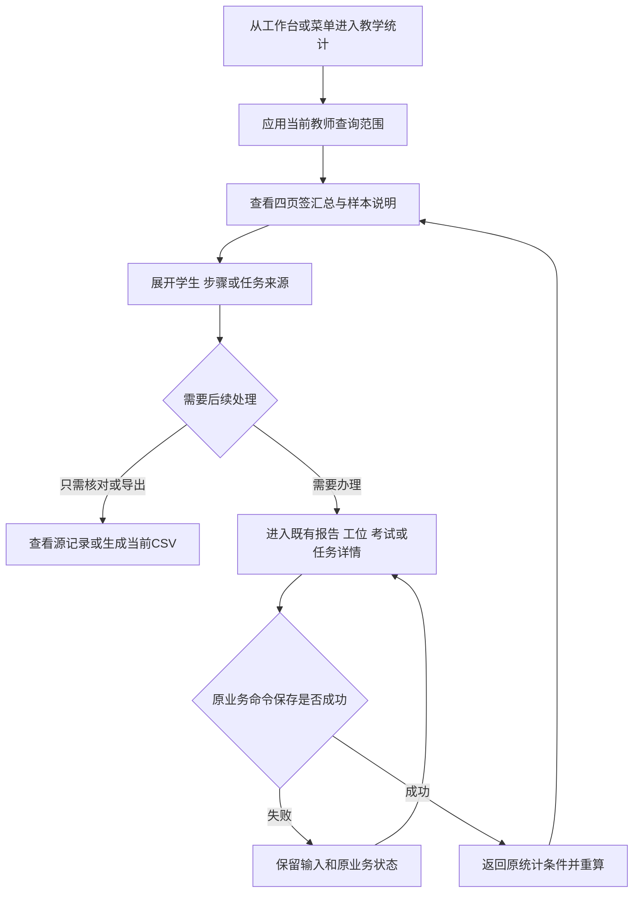

# 教师端教学统计：原型修改需求说明 V1.0

> 文档类型：原型前概念版PRD，现有产品的增量模块需求。  
> 状态：业务、13项功能、10个页面/交互载体方案均已逐轮确认；本文件汇总供后续原型实现使用。  
> 宿主系统：AI视觉实训操作流程智能评测系统；教师端。  
> 更新：2026-10-23。用户随后明确授权开工，原型实现与自动检查已完成，详见[实施记录](../xingchen-prototype/audit-2026-10-23/教学统计实施记录/实施说明.md)。仍不声称生产就绪或完成浏览器视觉验收。  
> 适用方式：在当前React原型中增量修改，保持现有操作链和数据；不另建一套统计产品。

## 修订与确认记录

| 阶段 | 用户裁定 | 当前状态 |
| --- | --- | --- |
| 业务范围 | “方案没问题，继续” | 一个一级菜单/四页签、本人数据、明细及CSV导出已确认 |
| 功能方案 | “继续” | F-001至F-013及关键口径已确认 |
| 页面方案 | “方案可以，开始吧” | P-001至P-010及新增/改造边界已确认，进入需求汇总交接 |
| 本版汇总 | 统一前述业务/功能/页面，补齐追踪与实施验收 | 不新增业务范围，不把需求汇总当作已完成实现 |

前三份草案保留为确认过程记录；本文件是本模块后续原型修改的统一需求依据。[实施交接与验收清单](05-原型实施交接与验收清单.md)仅展开工程联动和验证，不创造另一套业务规则。后续产品裁定应同时更新本文件修订记录及受影响交接项。

## 一、背景与问题

现有原型已经具备实训安排、工位操作、逐步确认、成绩与证据报告、求助办理、补证/线下补测和辅导任务。教师可处理单次实训，但难以在多个安排之间系统查看班级成绩、学生变化、步骤薄弱点和后续办理情况。

此前首页增加了统计范围筛选，用户明确认为工作台不适合承担完整筛选分析。现已移除首页筛选卡，保留简要指标与待办。本期将详细分析集中到独立“教学统计”入口，使教师能从汇总找到具体学生/步骤/任务，再进入原有业务流程处理，并返回原分析范围查看结果变化。

核心问题是分析和行动之间缺少统一入口与可核对数据，而不是缺少更多图表。所有显示数字都必须由实际记录推导，可解释分母、样本和排除原因，不允许用固定演示数字替代事实。

## 二、产品目标与验证

| 目标 | 业务结果 | 验证方式 |
| --- | --- | --- |
| 减少逐场找记录 | 可跨本人负责的安排查询班级和学生结果 | 从班级或学生筛选定位到源Session |
| 找到有依据的教学重点 | 同标准步骤分析能够解释当前确认扣分来源 | 扣分数量、人数、占比可逐条复算 |
| 看见变化而非假画像 | 同标准历次成绩与步骤对比，有样本限制 | 版本/时间未知不计算虚假提升 |
| 跟进工作可收束 | 从统计进入原办理，返回后状态和数量同步 | 求助/补证/辅导闭环及终态历史检查 |
| 当前分析可留存 | 导出当前集合的全部明细及范围/版本 | 文件行数、集合、版本与点击时一致 |

本期不编造教师节省工时、模型准确率等未经验证KPI。

## 三、范围与边界

覆盖当前教师负责的练习、考试结果及其任务；桌面与827px分屏可用。新增1个独立统计页、2个复杂抽屉、1个复用表单弹窗；局部改造6个既有页面。四个页签不是四个一级菜单。

明确不做：全校BI、教师绩效排名、任意报表设计、AI诊断/自动评语/技能画像、自动排课、校务系统对接、历史时点状态回放、旧报表原文件恢复、新权限体系或真实视频/模型接入。R03及原十四项暂缓问题仍是已知边界，不在统计中暗中修复或伪计已处理。

已有能力处理：成绩/证据/版本、求助/补证/辅导状态机及实际办理命令复用；只为统计新增安全来源定位、返回和必要读取能力。真实后台身份鉴权仍待后续接入；原型沿用已有演示教师，不能据此宣称生产权限已经落地。

CSV由当前一致的数据快照即时生成，首期不依赖外部文件服务；不新增报表任务中心、历史文件存储或假下载成功记录。

## 四、核心业务流程



关键分支：没有数据如实显示空态；没有有效分显示排除原因；不足两次或版本/顺序未知不计算提升；源对象取消/删除给说明和返回，不替换成其他Session；跨源上下文失效；失败不显示成功。统计查询、抽屉打开和导出均不改原成绩。

## 五、业务对象与状态

| 对象 | 来源与关系 | 在本模块中的含义 |
| --- | --- | --- |
| 安排 | 现有练习/考试；属于负责教师，关联学生分配及多个Session | 数据范围与单场参加名单来源 |
| Session结果 | 安排内稳定Session关联学生、工位、冻结标准、多个步骤 | 一次结果人次；成绩修订不产生新一次 |
| 步骤结果 | 一个Session内的Step | 同标准步骤分与确认扣分的最小样本 |
| 求助 | Session内独立请求，可多次创建但同一时刻只按原规则保留未结 | 单次帮助工作的状态与回执 |
| 补证/线下补测任务 | 原安排/学生/Session/Step关联独立任务 | 线下登记、教师确认与原成绩修订关联 |
| 辅导任务 | 学生、SOP/版本、类型与源结果关联 | 指导与复查工作，不等于再次改分或自动排课 |
| 统计查询上下文 | 当前教师/数据源、已应用条件、选择与分页 | UI查询状态，不是新业务对象，也不授予写权限 |
| CSV快照 | 点击时当前明细集合及口径 | 当前留存文件，不是可恢复旧版本的报表业务档案 |

状态沿用原业务枚举，不增加新的任务状态机：

| 对象 | 未结 | 成功终态 | 其他终态/限制 |
| --- | --- | --- | --- |
| 求助 | pending→handling | completed | cancelled/closed分别保留撤销/关闭原因 |
| 补证/补测 | pending→handling→awaiting_confirmation | completed | cancelled；确认仍须有效上下文及冻结守卫 |
| 辅导 | pending→coaching→awaiting_review | completed | cancelled；完成不改原成绩 |
| 成绩 | 过程记录/待复核 | 正式成绩/已发布 | 未参加/取消不当0分纳入；已发布冻结普通改分 |
| 流程确认 | 当前有效pending | 原流程记录的确认完成 | 自动完成/关闭保留原事实，不伪造AI证据 |

统计中的“待处理数量”“有效样本”“成功办结率”是以上状态的派生结果，不是另一套可以点击修改的业务状态。

## 六、角色与责任

负责教师可分析本人安排并在原权限内办理；不因一个学生上过自己的课而开放其其他教师结果。教师发起辅导、登记/确认线下依据、修订未冻结成绩均按原职责和审计执行。

学生不新增教师统计页访问权限；本人未发布考试的分数、正误、标准与内部说明仍按原投影隐藏。管理员不新增本模块统计入口；既有只读报告不因统计来源变成可改分。

统计页不直接判定“已解决”、不替教师完成复核、不自动发消息到外部系统。异步保存失败、数据过期与源对象失效时沿原规则保留输入并反馈；持久化成功后才重算成功状态。

## 七、用户故事及功能追踪

| 故事 | 作为/希望/以便 | 关联功能 |
| --- | --- | --- |
| US-001 | 作为教师，希望统一查询本人教学结果，以便不用逐场寻找和手工汇总 | F-001、F-002、F-003、F-004 |
| US-002 | 作为教师，希望查看学生在同标准下多次操作的变化，以便安排有针对性的指导 | F-005、F-009、F-010 |
| US-003 | 作为教师，希望定位有确认依据的薄弱步骤，以便调整讲解重点 | F-006、F-003、F-009 |
| US-004 | 作为负责教师，希望查看求助、补证、辅导和当前待办的状态，以便持续跟进直到真正完成 | F-007、F-008、F-012 |
| US-005 | 作为教师，希望核对统计来源并导出当前明细，以便复盘和留存依据 | F-009、F-011 |
| US-006 | 作为现有原型使用者，希望新统计兼容原数据和入口，以便持续演示与操作而不丢记录 | F-013、F-012、F-001 |

## 八、功能架构


```text
教师工作台：简要指标、工作安排、待办及统计入口
  └─ 教学统计（一个一级菜单）
      ├─ 班级成绩：结果汇总、成绩分布、班级/学生结果、单场参加记录
      ├─ 学生进步：历次成绩、同标准对比、步骤变化、关联辅导
      ├─ 步骤分析：步骤得分、已确认扣分、来源学生及依据
      └─ 教学跟进：求助/补证/辅导历史与现状；复核/流程确认/发布当前工作量

共用能力：数据范围和筛选、口径与排除说明、精确来源追溯、明细导出、返回恢复
既有流程：个人报告、考试结果、工位确认/求助、补证任务、辅导任务
后台规则：统一有效性判断与汇总、状态更新重算、关联数据兼容与演示迁移
```

四个页签不是四个一级菜单，也不各建一套分数规则。新统计只读取业务事实；真正改分、办结任务继续由原业务命令执行。

## 九、完整功能清单

| 编号 | 功能 | 类型 | 主要行为与触发结果 | 业务目的 | 承载位置 |
| --- | --- | --- | --- | --- | --- |
| F-001 | 统计入口与工作台衔接 | 用户操作、既有能力改造 | 从左侧菜单进入统计；从首页指标进入相应分析；保留首页简要指标和待办，避免重新放回筛选卡 | 让分析有统一入口，保持工作台简洁 | 教学统计宿主及教师工作台 |
| F-002 | 统一查询范围 | 用户操作、系统自动 | 按班级、课程、SOP/版本、类型、日期查询；联动清理失效选项；显示当前范围并重置；按教师限制候选数据 | 控制分析对象，避免数字/明细范围不同 | 统计共用区域与四页签 |
| F-003 | 有效样本及口径解释 | 系统自动、数据展示 | 加载或业务数据更新时判定有效/排除；计算样本数、分母和排除原因；保分与证据来源分类 | 让统计可复算，避免把无效分或未知当0 | 共用口径与来源说明；非页面计算能力 |
| F-004 | 班级成绩分析 | 数据展示、用户操作 | 查看班级汇总、分布、学生结果；同标准比较；进入单个安排看应参加、已参加、未参加和待核对记录 | 了解整体结果及具体学生情况 | 班级成绩页签及对应来源明细 |
| F-005 | 学生历次进步分析 | 数据展示、系统自动、用户操作 | 选择学生和同标准单元，查看历次有效分与首末变化；按步骤对比；打开任一次源报告 | 观察变化，保留原始证据 | 学生进步页签及对应来源明细 |
| F-006 | 步骤得分与扣分分析 | 数据展示、系统自动、用户操作 | 汇总同SOP版本步骤分、已确认扣分人次/人数及占比；查看具体来源和当前分版本 | 识别需要重点教学的步骤 | 步骤分析页签及对应来源明细 |
| F-007 | 求助、补证和辅导跟进 | 数据展示、用户操作 | 分类型查看状态数量、历史与当前记录；区分完成、取消、关闭；进入精确任务办理后更新统计 | 跟进问题办理，避免“看得到办不了” | 教学跟进页签与已有任务详情 |
| F-008 | 复核、流程确认和考试发布工作量 | 数据展示、既有能力复用 | 查看当前待复核、待确认及待发布来源；分别进入报告、工位或考试结果；不虚构历史工单 | 统一发现尚待处理的教学工作 | 教学跟进页签与已有业务页面 |
| F-009 | 来源记录与成绩版本追溯 | 用户操作、数据展示 | 从指标、学生、步骤打开同一批来源；显示Session、Step、原分/满分、有效版本及依据；排除记录也可解释 | 让每个数字可核对，防止链接到错误会话 | 各页签来源明细及已有个人报告 |
| F-010 | 低分辅导发起与关联 | 用户操作、既有能力复用 | 从当前范围最新有效低分结果发起辅导，填写原因/要求；已有同目标未结任务则进入原任务；完成不改原分 | 从发现问题进入教学行动 | 学生相关明细与已有辅导表单/任务 |
| F-011 | 当前筛选明细导出 | 用户操作、系统文件生成 | 导出当前激活明细集合的全部符合条件记录，包含口径、时间、单位、分数和版本；失败可重试 | 支持复盘、核对和留存当前结果 | 四页签明细区域；非页面文件生成能力 |
| F-012 | 跨页返回与最新结果重算 | 用户操作、系统自动、既有页面改造 | 保留页签/筛选/选择对象/分页；从报告、任务返回重算；对象失效给说明；数据源切换清除旧源上下文 | 保证查询—办理—回看闭环 | 统计及原业务页面的来源返回入口 |
| F-013 | 历史兼容与关联演示数据 | 系统自动、数据兼容 | 兼容缺字段与旧版本；追加可追溯演示包并幂等迁移；保留旧成绩、快照和两套数据源 | 让新功能在现有原型数据上可用 | 非页面迁移能力、统计空态及来源说明 |


全部13项均属本期；执行先后见交接清单，不将后做的能力误标成范围外。功能编号对应的业务规则集中在第十二章，页面承载见第十一章和第十三章。

## 十、完整页面与交互载体清单

| 页面 | 名称与形态 | 新增/复用/改造 | 关联功能 | 定位、核心区域与主要功能 | 默认状态 | 关键操作条件 |
| --- | --- | --- | --- | --- | --- | --- |
| P-001 | 教学统计主页面，四页签 | 新增独立页面 | F-001至F-009、F-011至F-013 | 共用筛选、范围摘要、四页签分析、图表/列表、口径说明；查看来源/进入办理 | 首次班级成绩，当前教师全部可访问记录；比较未选标准时不画可比趋势 | 分析本人数据；对比须同SOP明确版本与类型 |
| P-002 | 统计来源明细抽屉 | 新增复杂抽屉 | F-003至F-012 | 展示所点指标的精确来源、分母/排除原因、学生/步骤/任务明细、导出与源报告入口 | 指标对应集合，第1页；保留宿主筛选 | 成绩只读；办理与辅导入口按来源状态校验 |
| P-003 | 单场参加情况抽屉 | 新增复杂抽屉 | F-004、F-009、F-011至F-013 | 安排摘要、实际应参加名单、已参加/未参加/待核对、Session定位 | 所选安排全名单，不按结果日期裁剪 | 仅本教师安排；歧义记录先选Session，不自动补人 |
| P-004 | 安排辅导弹窗 | 复用现有表单和命令，新增承载 | F-010、F-012 | 来源成绩、发起原因、学生要求、保存/取消、重复任务关联 | 带入源结果与版本；要求为空必填 | 本范围最新有效低分、负责教师、来源版本与任务防重按原发起规则校验；已冻结源成绩只读 |
| P-005 | 教师工作台 | 既有页面改造 | F-001、F-003、F-012 | 保留简要指标、安排、待办；统计入口指向对应页签 | 原工作台布局，统计筛选区不恢复 | 仅改统计导航与共用读取，不改变待办办理归属 |
| P-006 | 练习/考试个人报告 | 既有页面改造；共用报告形态 | F-009、F-010、F-012 | 精确Session/Step、成绩/证据/版本、复核及任务，新增来源返回 | 对应学生结果和所点步骤；原数据保留 | 已发布/冻结只读成绩；原教师修订守卫继续有效 |
| P-007 | 练习/考试工位详情 | 既有页面改造；共用监控形态 | F-007至F-009、F-012 | 原画面/当前步骤/事件，定位求助或流程确认；来源返回 | 对应Session及指定办理区 | 终态只读；人工确认/求助办理按原守卫，绝不启用废弃模拟区 |
| P-008 | 考试结果汇总页 | 既有页面改造 | F-008、F-009、F-012 | 原结果列表/发布预检，定位相关结果，新增来源返回 | 指定考试；存在指定Session时定位对应行 | 发布仍须真实命令校验；统计不绕过预检 |
| P-009 | 补证/线下补测任务详情 | 既有页面改造 | F-007、F-009、F-012 | 原任务摘要、登记、确认、取消及历史，新增来源返回 | 指定任务当前状态 | 已完成/取消只读历史；负责教师及版本/冻结守卫继续有效 |
| P-010 | 学生辅导任务详情 | 既有页面改造 | F-007、F-009、F-010、F-012 | 原指导/复查/引用/取消及历史，新增来源返回 | 指定任务；新建后从待安排开始 | 负责教师办理；状态/引用版本校验；完成不改原成绩 |


## 十一、逐页设计说明

以下共用约定适用于全部页面；具体页面逐项展开，不以“同上”替代。


### 3.1 视觉与信息层级

沿用现有浅色后台与字号规范：页标题26px、面板标题16px、正文13px、次要说明12px。长说明放“口径说明”或明细，避免新增长卡片挤占主视觉。无需单独的统计大屏。

桌面主区域采用“标题 → 共用筛选 → 四页签 → 当前页签内容”；筛选支持收起并保留简短范围摘要。分屏/827px下筛选换行，表格只在自身容器横向滚动，抽屉可占满内容宽度，不靠缩小正文排版。沿用原型组件，保留键盘可用的表格/按钮/页签与清晰标签。

### 3.2 查询、空态与分页

- “应用筛选”才更新结果；输入与已应用条件区分。修改未应用时提示尚未应用，避免图表仍旧却被误认为新条件；导出只针对已应用条件。
- 首次当前教师+全部记录；有明确来源入口时采用来源条件。SOP/版本/类型选择不足时，班级成绩可看概览，学生对比和步骤对比显示选择引导，不擅自选第一条版本。
- 筛选变化后主体列表回第1页，关闭不再适用的明细抽屉；原抽屉是旧查询结果时不继续保留。
- 建议新统计列表每页10条，提供10/20/50选择；查询、排序改变回第1页。此为页面方案默认，不改原业务页既有分页。
- 有效分显示一位小数；原分/满分按存储精度展示，归类和计算先用原精度。排序按真实数值而不是显示字符串。
- 无记录、无有效成绩、范围无匹配、样本不足、缺少历史信息、加载失败、无权限/来源失效分别解释。分母0不填0%，缺值不填0分。
- 加载/更新失败保留上一成功结果并明确不是最新；此时先完成刷新再导出，避免下载与“当前结果”含义不清。
- 普通确认、口径说明、导出反馈不单独建页。统计明细只读抽屉可以直接关闭；辅导表单有未保存输入时离开应提示。

### 3.3 返回与定位

返回上下文包含：数据源、页签、已应用筛选、选择的学生/步骤/任务类别、来源明细对象、分页和排序。它不携带改分权限，也不把分数/内部依据塞进URL。

建议新增主路由`/teacher/statistics`，页签和必要选择可用可恢复的查询状态表达；新路由仅是待实现方案，不是已经存在的入口。原业务页路由保留。

跨页返回仅接受系统内合法统计来源。直接打开报告或任务详情时，不显示失效的“返回教学统计”，原返回行为保留。浏览器后退和显式返回都应恢复最近成功查询；数据源已变时清除旧上下文，不能把旧Session拿到新源查找。

同源数据变化后重新计算：记录仍匹配则恢复定位；不匹配时解释“状态或成绩已变化，已退出此集合”，回合法页码。不同步重写原业务对象。


### P-001 教学统计主页面

**定位/角色**：负责教师的统一分析工作区。入口为新增菜单、首页统计摘要、统计返回链接。出口为P-002/P-003/P-004及已有办理页。左侧“教学统计”在该页面激活；不会出现四个并列一级菜单。

**核心结构**：

```text
教学统计                                      刷新 / 口径说明
当前教师 · 当前数据源
班级 / 课程 / SOP / 版本 / 类型 / 日期          应用 / 重置 / 收起
已应用范围摘要
班级成绩 | 学生进步 | 步骤分析 | 教学跟进
当前页签的摘要、图表/列表与来源入口
```

顶部只显示必要身份/数据范围，长篇口径放说明层；不再展示大块“原型技术实现”文字。

#### 班级成绩页签

- 默认：全部可访问记录的概览；摘要为有效学生数、有效结果人次、平均分、参考及格率（60分），旁边给排除记录入口。
- 图表：成绩四区间分布。点击区间打开P-002该区间结果；平均分点击是全部有效结果，人数点击先是去重学生集合。
- 主列表：按班级显示归属来源、学生数、有效人次、平均分和参考及格率；默认班级名称排序，未知归属单列。可按均分排序，但不同标准概览不标名次/优劣。
- 主要操作：“查看结果明细”进入P-002；“查看学生进步”切到学生页签并带入学生及适用范围；“查看安排参加情况”先明确选择当前范围涉及的一个本人安排，再打开P-003。
- 班级对比：只有单SOP明确版本及一种类型选定后可显示同标准班级对比；未选齐时说明条件，不生成跨标准排名图。
- 导出：先选择“全部有效结果”或某班/某区间明细，再在P-002导出该集合。避免导出按钮挂在班级汇总表上却下载未说明的原始人次。
- 特殊状态：只有待复核/无效成绩时摘要无有效样本，仍允许看排除原因和原报告；不把未参加变0分。

#### 学生进步页签

- 默认：保留共同筛选，未指定学生时显示学生选择和相关记录数量；不默认分析第一名学生。来自班级行的入口则带入学生。
- 学生选定后先列其可用SOP/版本/类型组合；单元选齐前可看历史条目，但不画一条跨标准趋势线。
- 摘要：可比有效次数、首次分、最近分、变化分；不足两次或顺序不可靠时说明原因，变化显示“—”。
- 图表：同单元按可信结果时间的历次百分制分数；可点任一次查看原报告。分数下降正常显示，保分/人工/演示证据标识可查。
- 主列表：时间、安排、原分/满分、百分制、成绩版本、依据与源结果入口。未知时间条目单列，不在时间轴上猜位置。
- 两次比较：教师最多选两次可比结果，显示同Step的两次原分/满分与变化；条件不满足时保留历史查看，说明不能比较。
- 辅导：当前范围最新有效低分提供P-004；已有同目标未结任务提供P-010。旧低分和未知版本仍可看源报告，不能让“进步图”自动生成新任务。
- 导出：列表“导出历次明细（N条）”导出当前学生/标准/类型范围内的激活集合；想看排除记录时明确切到排除集合后导出，不混入有效序列。
- 特殊状态：学生失效、选择范围无结果、仅一次、版本未知、同时间歧义分别解释；不显示“提升0分”掩盖不足。

#### 步骤分析页签

- 默认：保留筛选。未指定SOP明确版本及结果类型时，显示选择引导及可用标准，不自动跨版本计算。
- 摘要：当前单元有效结果人次、已确认扣分涉及学生数；不提供“掌握率”“模型准确率”。
- 主图/列表：按SOP步骤顺序展示步骤名、满分、平均分/得分率、有效样本人次、确认扣分人次、涉及人数、扣分占比。点击确认扣分数打开P-002扣分来源；点击样本数打开该步骤有效样本来源。
- 默认不把分数最低的步骤直接标成“最差技能”；可按确认扣分人次或占比排序，展示分母。
- 明细操作：原报告定位到同一Session/Step；需要复核则在P-006办理，统计页不能直接撤销扣分。
- 导出：P-002中可导出某步骤的有效样本或扣分来源，标题/单位分别说明，不拿事件条数充当结果人次。
- 特殊状态：无有效结果、步骤无样本、无已确认扣分、依据未知、旧步骤缺失分别显示；无确认错误不等于AI判断全部正确。

#### 教学跟进页签

分成两个清晰分区，避免同一个日期条件有两种含义却不说明：

1. **求助/补证/辅导记录**：默认“学生求助”，可切换另两类；类别不是新增主页面。范围说明“按创建日期选记录，展示当前状态”。显示全部、未结、成功完成、取消/关闭、未知的状态分布，以及该类型办结率和分子/分母。主列表默认未结优先，再按可信创建时间倒序；未知时间后置。
2. **当前待处理工作**：默认“成绩复核”，可切到“流程确认”“考试发布”。明确“当前待办，日期筛选不适用”，其他班级/SOP/类型范围仍生效。复核/确认显示数量及来源列表；考试显示待发布场数、有效结果份数、发布率和待复核份数，单位不混合。

记录字段：类型、学生/安排、任务/来源标识、创建时间、当前状态、负责教师、当前办理入口；已完成/取消只提供历史查看。考试发布行以安排为单位，并可打开其结果份数来源。

操作分别到P-007/P-009/P-010/P-006/P-008，不能在统计列表直接点击“标记已解决”。导出只对当前激活分区和集合生成文件：有任务ID时以任务为单位；当前复核等以明确标注的Session/Step或安排为单位，不伪造任务ID。

来源失效但留有历史对象时保留历史说明；暂缓的异常处置和R03如实显示，不通过统计改变状态。

### P-002 统计来源明细抽屉

**定位/角色**：教师核对某个数字由哪些记录组成；是P-001上的同一个抽屉形态，按来源类型切换字段，不为每个指标建一个独立页面。关联F-003至F-012。

**入口/出口**：指标数、分布区间、班级/学生/步骤数量、任务状态数量打开；关闭回P-001原状态；查看报告/办理跳到P-006至P-010，返回可恢复此抽屉。

**核心区域**：标题（如“80至不足90分 · 结果明细”）→已应用范围/时间依据/统计单位→口径与总数→只读表格→分页及“导出此明细（N条）”。

**不同来源的呈现**：

| 来源 | 第一层对象和主要字段 | 关键入口 |
| --- | --- | --- |
| 平均分/分布/及格率 | Session：学生、安排、结果时间、原分/满分、百分制、SOP版本、成绩版本、依据 | 查看源报告 |
| 学生人数 | 去重学生：姓名/学号、来源班级标记、有效结果人次 | 展开该学生Session列表/查看进步；导出说明当前单位是学生 |
| 步骤样本/扣分 | Session-Step：学生、步骤、分数/满分、确认说明、成绩版本 | 查看原报告此步骤 |
| 排除记录 | Session及多项排除原因；时间/归属未知标记 | 查看仍允许访问的源记录，不可强制纳入 |
| 任务状态 | 任务：类型/ID、学生、来源安排、创建时间、当前状态、责任人 | 办理或查看历史 |
| 考试结果份数 | 考试Session：已发布/可发布/待核对类别、分数有效性、源考试 | 查看考试结果或个人报告 |
| 当前待办来源 | 复核Session/Step、确认请求或考试安排；用来源组合识别，不伪造工单 | 对应原业务入口 |

**默认状态**：进入所点集合第1页，结果按可信时间倒序；人数集合按姓名/学号排序；未知时间末尾。抽屉可筛选该来源的状态/学生，但必须显示为额外条件，并同步导出，不改宿主全局条件。

**关键操作条件**：已发布源成绩只能查看；未结任务由原负责教师办理；低分辅导只对符合F-010的最新结果出现。没有对象的集合显示无记录，CSV按钮禁用；更新后N变化要重算和告知，不下载旧条数混合文件。

**业务状态/约束**：只读抽屉不自动核定成绩，不因关闭写入状态；来源删除/取消/改分后给出当前变化；失效链接不改取第一条同学生记录。未知满分、分数或依据保持未知。

### P-003 单场参加情况抽屉

**定位/角色**：教师核对一个安排应参加的学生是否有明确记录；与成绩抽屉分开，防止人名单被成绩日期范围裁剪。关联F-004/F-009/F-011至F-013。

**入口/出口**：P-001选择一个本人安排后进入；关闭恢复统计范围；有效结果可到P-006，正在进行的有效Session可到P-007。选择安排本身是普通单选控件，不另建页面。

**核心区域**：安排名称、类型、SOP/版本、状态、当次分配摘要；标注“本安排名单，不按结果日期裁剪”；应参加人数、已参加人数、明确未参加人数、待核对人数；完整名单表和导出。

**主要字段**：学生/学号、分配工位、参加状态、Session标识、结果状态、是否有可信开始/交卷记录、来源说明。已有结果只展示允许读取的当前版本，不补假成绩。

**默认状态**：全部应参加名单，按已存分配顺序；支持按参加状态查看。导出默认当前状态筛选下的全部名单，单位是“安排内学生”，不是完成结果人次。

**关键条件**：应参加名单从保存分配/已有明确参与者还原，不从班级总人数拉全班。多个历史Session无法确定目标时允许查看并选择，未选前不自动跳报告；缺少Session显示待核对。仅明确终态未参加显示未参加，未开始或运行中不显示缺考。

**边界**：预期名单无法可靠还原时标“分配记录待核对”，不伪造应参加总数和分组相加等式；发现名单外历史结果单列说明，不悄悄加入应参加分母。无原业务支持的“补建记录”不在本抽屉提供。

### P-004 安排辅导弹窗

**定位/角色**：将符合条件的低分来源交给原辅导流程；复用现有创建组件/命令的校验与保存行为，不新增辅导状态机。关联F-010/F-012。

**入口/出口**：P-001学生进步或P-002的可发起低分来源进入；成功到P-010并保留统计来源，取消回原位置。与既有个人报告上的辅导创建共用规则。

**核心区域**：学生/源安排/SOP版本、原分/满分、成绩版本、统计范围摘要；发起原因、学生要求；保存/取消及错误说明。

**默认状态**：原因带入低分依据，学生要求为空；捕获打开时来源版本与选择范围。没有自动创建、不自动恢复旧表单。

**关键条件**：当前教师负责、最新有效低分低于80、目标清楚；填写原因和要求后保存。相同学生+SOP/版本+类型已有未结辅导时进入原任务。成绩冻结不禁止独立辅导，但任何操作不得改原分。

**状态与异常**：重复提交防重；源成绩或资格变化则保留输入并提示重新核对，不能用旧上下文保存；保存失败不关闭、不显示成功。取消/关闭时如有修改先提示丢弃或继续填写。数据源切换后表单必须失效。

### P-005 教师工作台改造

**定位/角色/证据**：当前教师日常工作入口；现有`/teacher/dashboard`及Dashboard、DashboardPerformanceSection。关联F-001/F-003/F-012。

**核心区域与变更**：今日安排、正在进行、待办保留；学生表现三指标与高频错误保留简要摘要。新增“查看教学统计”入口，不恢复已删除的筛选卡，也不在首页继续展开完整统计工作区。

**入口/出口**：菜单直达P-001默认班级成绩；均分→班级成绩；发布率→教学跟进的考试发布；辅导数→教学跟进辅导；错误→步骤分析对应标准/步骤。求助/补证等具体待办仍直接去原办理详情。

**默认状态**：原全部演示记录摘要与安排日期策略不变；数值使用共用选择器。原首页`metric=average/publishing/support/errors`深链接兼容映射到P-001对应内容，不留空锚点。

**权限/状态/约束**：没有样本时仍可进入统计查看原因；入口不增加他人数据权限。仅涉及统计入口和来源的联动，不改原工作台布局、学生访问或暂缓的异常处置。

### P-006 个人报告改造（练习与考试共用）

**定位/角色/证据**：原学生个人结果/证据报告，现有`/teacher/practices/:id/students/:studentId`与考试对应路径。关联F-009/F-010/F-012。

**入口/出口**：P-001/P-002/P-003指向明确Session，可附带Step；从统计进入时增加“返回教学统计”，回原条件和来源抽屉。直接从练习/考试管理进入仍保留原返回目的地。

**核心区域与变更**：原成绩摘要、步骤列表、证据、复核/处置、补证与辅导区域保留；只增加安全的来源返回和指定步骤定位，不再叠加一张巨大的“统计说明”卡。

**默认状态**：精确打开指定Session/Step，保留有效成绩与原判/审计。多个历史Session时不取第一条冒充目标；失效目标给返回说明。

**关键条件**：原责任教师按原规则复核/调分/发起任务；已发布/冻结成绩只读，统计来源不改变权限。保分、人工流程与AI证据依旧分开；无视频不伪造片段。

**状态与返回**：保存失败保留理由；未保存离开沿原保护。保存成功返回后重算，来源退出原集合时解释。管理员只读和学生未发布考试投影不增加编辑入口或泄露信息。

### P-007 工位详情改造（练习与考试共用）

**定位/角色/证据**：原`/teacher/practices/:id/stations/:stationId`及考试对应路径，StudentMonitorPage等共用实现。关联F-007至F-009/F-012。

**入口/出口**：求助或流程确认来源携带精确Session、请求/步骤标识；定位“学生求助办理”或“步骤流程确认”正式区域；返回P-001教学跟进原类型/筛选。原总监控入口不改变返回方向。

**核心区域与变更**：画面、SOP步骤与紧凑当前结果保持；新增来源返回，使用现有办理区，不在上方插入长统计卡，不恢复运行状态模拟区。

**默认状态**：当前被请求的Session与办理对象。对象已经办理完时展示当前终态与历史，不能重新生成一条待办。

**关键条件**：求助按待接手→处理中→完成/关闭规则；流程确认按教师、当前步骤、安排/Session运行状态及安全阻断校验。来自统计不是恢复故障/终态会话的授权。

**边界**：旧会话不再适合实时监控时展示历史/结果入口，不切成新会话画面代替。请求ID失效但Session存在时可读Session并说明找不到指定请求；不能办理其他请求冒充完成。

### P-008 考试结果汇总改造

**定位/角色/证据**：原`/teacher/exams/:id/results`，ResultsPage。关联F-008/F-009/F-012。

**入口/出口**：教学跟进考试发布或P-002考试结果明细进入；返回教学统计恢复发布内容与查询。原考试管理入口仍回考试管理。

**核心区域与变更**：原考试结果摘要、学生列表、待复核与发布预检保留；增加来源返回、指定Session行定位。结果份数与场次的单位在统计入口和本页保持一致。

**默认状态**：指定考试的现有当前结果；可定位对应学生而不更换考试。无有效成绩/满分依据时显示原预检原因。

**关键条件**：仅待发布考试、有效正式结果、复核/处置/任务/安全要求均满足时由原命令发布。打开统计时满足不等于点击发布时仍满足，执行前继续校验最新事实；冻结版本不得被普通改分。

**状态与返回**：成功后返回统计更新已发布/待发布份数；失败保留原因并可回源处理。统计来源不改未参加记录，也不为修复历史错误实施发布后更正流程。

### P-009 补证/线下补测任务详情改造

**定位/角色/证据**：原`/teacher/evidence-tasks/:taskId`，EvidenceTaskPage与EvidenceTaskDetails。关联F-007/F-009/F-012。

**入口/出口**：统计任务列表/来源抽屉进入；增加“返回教学统计”，同时仍允许查看原报告。直接打开任务时原返回教师工作台行为保留。

**核心区域与变更**：任务来源、状态、办理过程、核验依据、确认结论、历史不改业务结构；新增来源返回和状态变更后的回看衔接。

**默认状态**：指定任务当前状态；待办理可接手，办理中可登记，待确认可确认，已完成/取消展示只读历史。无指定任务时显示失效说明和返回。

**关键条件**：负责教师、任务修订和成绩上下文继续校验；确认有效分变化仍走统一成绩修订；已发布冻结守卫继续执行。取消只走原命令，不借统计入口制造补测完成。

**业务状态与边界**：空成绩办理不补满分；登记完未确认不计成功；R03多任务取消残留待复核尚暂缓，返回统计如实显示，不在本页补修。保存失败保留输入，成功返回按新状态退出未结集合但历史可查。

### P-010 学生辅导任务详情改造

**定位/角色/证据**：原`/teacher/support-tasks/:taskId`，SupportTaskPage/SupportTaskDetails。关联F-007/F-009/F-010/F-012。

**入口/出口**：统计辅导列表、低分来源关联或P-004保存成功进入；增加统计来源返回；原工作台/报告进入时保留原路径。可查看源报告与复查引用。

**核心区域与变更**：原低分依据、学生要求、开始辅导、指导登记、复查/引用、取消、历史保留；仅新增返回和正确回看，不建第二套辅导登记区。

**默认状态**：当前任务状态；待安排可开始，辅导中可登记，待复查可复查，已完成/取消只读。新建任务进入待安排，已有同目标任务则进入其当前状态，不重置。

**关键条件**：原负责教师及任务修订守卫；引用后续正式练习须本人同SOP/明确版本且版本未过期，或使用原线下核验依据；源成绩已修订时保留发起快照并标注变化。

**状态与返回**：完成只改变辅导状态，原成绩不变；返回统计后未结人数/任务数减少，但学生仍可能低分。失败保留填写内容；失效来源按原规则保留历史并解释，不自动替换成其他结果。


## 十二、核心业务规则与功能定义

本章是指标与查询规则的统一依据。不得在图表、明细、导出或首页各写一套不同算法。


### F-001：统计入口与工作台衔接

新增菜单名称“教学统计”；首次直接进入默认“班级成绩”。从首页某指标进入时，根据语义定位到对应内容：平均得分进入班级成绩，考试发布率进入教学跟进的考试发布内容，待辅导学生进入教学跟进的辅导内容，高频错误进入步骤分析。链接可携带当前已选对象，但不得自动扩大教师范围。

保留首页三指标与高频错误摘要；将其详细分析入口指向统计，避免长期维护两套统计明细。求助、补证、辅导等待办仍直接进入对应办理页面。首页不增加班级/日期等筛选区。

迁移已有首页明细深链接时，应兼容原有入口并进入相应统计内容，不能因移除旧区域而出现空页面；具体落点和页面参数在页面方案中确定。

### F-002：统一查询范围

1. 首次默认当前教师、全部可访问班级/课程/标准/类型/日期，不依真实当天过滤演示数据；默认条件明确展示，不用“近期”代替。
2. 一期采用班级、课程、SOP、版本、结果类型单选，“全部”为合法选项；学生进步另有学生选择。日期可只填起点或终点；开始晚于结束时阻止应用，保留输入和上一成功结果。
3. 选课程后只保留关联SOP；选SOP后只保留该SOP记录版本；上级变化使下级不适用时清除下级，并明确提示，不在隐藏处继续过滤。
4. 默认“全部”可以浏览概览；要做班级横向比较、学生变化或步骤对比，须选择同一SOP、明确版本、练习或考试一种类型。版本未知记录可看来源，不能放进可比序列。
5. 四页签共享适用的查询范围；切换页签不自动把全部日期改成最近30天，也不丢失班级/SOP。学生或步骤选择不再适用时清除并说明原因。
6. 日期按校内展示时区Asia/Shanghai的完整自然日解释，开始/结束日均包含；能区分时区的存储时间按其真实时刻转换，旧无时区记录按原型既有本地口径并标明历史来源。
7. 成绩分析按实际结果形成时间过滤：优先明确交卷/完成时间，之后采用已记录的结果生成时间，再使用实际整场结束时间；不拿计划开始/结束时间冒充结果时间。没有可信时间时，全日期可查看、日期筛选下不参与该日期集合，并列明排除数。
8. 求助/补证/辅导按创建时间选取记录，看这些记录现在的状态；创建日期未知的旧记录在全日期下展示，日期筛选时单列未知。当前复核/确认/发布工作量不套用任务创建日期，分区明确标注“当前待办，日期筛选不适用”；班级/SOP/类型范围仍生效。
9. 首页的全部日期摘要不改现有数值口径；新模块与首页共用真实时间提取规则，移除计划时间作为实际结果时间的兜底，保留未知标识。不能改写旧数据以补足时间。此项属于统计联动，不实施有效用时持续累计的暂缓问题。

### F-003：有效样本与口径解释

- 最小结果对象为安排+Session，最小步骤对象为该结果+Step。重新核定同一Session不形成新的人次。
- 正式有效结果需已结束/提交、结果正式或已发布、分数及满分合法、无待复核/待处置/未完成补证/待确认安全要求；沿用当前已修复的共享有效性规则，不另写宽松版本。
- 练习和考试可在概览中合看，但要标明；同标准对比则分开。未发布考试中，负责教师可查看已核定结果；学生和公共大屏的保密规则不变。
- 明确空值不是0，非法分不补满分；合法0分纳入。缺证保分仍是政策有效分，不能显示成AI准确率或技能掌握率。
- 把总排除记录数与逐原因计数分开；同一记录可有多个排除原因，所以各原因之和可能大于总排除数。
- 每一指标能查看计算口径、分子/分母或样本、来源结果和排除说明。采用一套事实集合供数字、图表、表格与导出读取。
- 同一结果可能同时涉及保分、人工确认和AI证据；依据标签可以并存，不能强行互斥饼图化。依据覆盖数量如显示，须注明可重复计数。

### F-004：班级成绩分析

建议一期指标：有有效结果的学生人数、有效正式结果人次、平均得分、参考及格率、成绩分布，以及待核对/待复核记录数。

- 平均得分＝各有效结果百分制得分之和÷有效结果人次；原分/满分可查。相同学生3次结果计3人次、学生人数计1人。
- 参考及格率＝百分制得分≥60的人次÷有效结果人次；名称注明“统计参考线60分”，不是对学校正式制度的声明，也不是辅导阈值。
- 分布区间固定为0≤分<60、60≤分<80、80≤分<90、90≤分≤100；四组之和等于有效结果人次。先用原精度分组，显示时再四舍五入。
- 选择班级可看班级结果及学生汇总，查看某学生可进入学生进步或源结果。无有效分的学生可显示待核对状态，不能填0分参与均值。
- 班级对比限定同SOP明确版本和同一类型；显示样本人次与学生数，不把不同重复次数或样本差异隐藏成排名结论。跨标准概览仅为描述性汇总。
- 参加情况在选中单个安排后查看：应参加来自实际学生分配，明确已开始/已交卷等事实计已参加，明确“未参加”计未参加；缺Session或有歧义计待核对。不是按当前班级总人数推算。
- 首期不生成跨安排综合出勤率。单场参加详情展示整个安排名单，明确“本安排参加情况，不按结果形成日期裁剪”；不混入成绩分布的分母。
- 班级归属优先历史已记录信息；仅能用当前学生班级时显示“按当前班级归属”，未知单列。新安排应在形成Session时保留当次学生/班级标识来源；历史数据不补造旧班级快照。

### F-005：学生历次进步分析

同一学生、同SOP身份、明确记录版本、同一练习/考试类型构成一个可比序列。

1. 所选日期范围内，有至少两次有效且先后可确认的结果，显示首次、最近和变化分数；变化＝最近百分制分－首次百分制分。低于0如实显示下降，不删除低分记录。
2. 只有一次结果时不显示0提升；显示“尚不足以比较”。缺少时间或相同时间无法确认先后，不按ID猜测顺序，也不计算假变化。
3. 历次结果保留成绩有效版本、源安排、结果时间和依据；可选择两次同标准结果看步骤分变化。更改成绩只更新本次当前有效值，不增加一次练习。
4. 不将未知版本合成一个可比组，不跨版本连接趋势线；更换版本后重新选可比序列。不同类型可看历史，但不合成一个提升结论。
5. 学生的已有辅导记录显示来源与当前状态，可查看办理结果；辅导已完成不等于成绩已提高。
6. 看见低分时调用F-010，不能随意用序列中任一旧低分创建重复辅导。

### F-006：步骤得分与已确认扣分分析

- 对比单元是SOP身份+明确版本+结果类型；同名步骤不跨SOP/版本合并，Step ID是稳定定位依据。
- 步骤平均分按纳入的有效正式结果中该步骤有效分计算，同时显示满分；不同步骤满分不同，如放在同图比较用得分率，并保留原分。
- 已确认扣分人次：当前仍有有效扣分且具备既有确认依据的Session-Step去重数；涉及学生人数另按studentId去重。
- 扣分占比＝该步骤已确认扣分人次÷该步骤有效样本人次，分母为0显示无样本。步骤不存在或未操作的结果不纳入该步骤样本。
- 复用已有确认来源规则，包括可追溯的教师确认、有效评分规则或明确记录依据；普通结束审计、低分但无依据、缺录像本身都不能当已确认错误。演示/历史来源继续标注，不宣传成现场模型评测。
- 每条有源学生、Session、步骤、原分/满分、确认说明和成绩版本。点击定位原报告具体步骤，复核修订后以当前有效分重算，历史审计不删除。
- 证据未知、保分、人工推进与成绩分开解释，人工推进不进入“AI确认完成”统计。

### F-007：求助、补证/补测与辅导跟进

按类型查看稳定ID记录的状态分布和历史，学生/安排/SOP等筛选跟随来源。每种类型独立统计，不直接求一个统一办结率。

| 类型 | 未结集合 | 成功办结集合 | 单列且不计办结率分母 | 未知 |
| --- | --- | --- | --- | --- |
| 求助 | pending、handling | completed | cancelled、closed；分别解释学生撤销/随会话关闭 | 未知状态单列，不算已处理 |
| 补证/线下补测 | pending、handling、awaiting_confirmation | completed | cancelled，说明取消/关联失效 | 未知状态单列 |
| 辅导 | pending、coaching、awaiting_review | completed | cancelled，说明取消/关联失效 | 未知状态单列 |

各类型办结率＝成功办结数÷（未结数＋成功办结数）；分母为0显示暂无可统计任务。按创建时间进入查询集合后展示当前状态；不是按完成日期计算“本月办结量”。取消/自动关闭/未知虽不进分母，仍在该类型全部来源中展示，所以状态分布全部分组之和应等于查询记录总数。

求助已读不算完成；补证登记完未确认不算完成；辅导待复查不算完成。办理链接分别进入原工位求助、补证详情、辅导详情；统计页不新建旁路办结按钮。

不能办理的终态只读看历史。失效关联保留可查事实并提示原因，不拿另一个Session顶替。当前没有可靠接手/完成时间的旧记录不计算响应时长；不开展教师效率排名。

### F-008：当前复核、流程确认与考试发布工作量

1. 当前待复核以现存步骤/Session事实为准；同一步骤已由未结补证任务接管时，延续现有去重规则，避免重复显示两个办理入口。
2. 人工流程确认只列仍有效的当前步骤确认请求，定位该Session工位确认区；历史已关闭请求不算当前待办。
3. 考试发布分开展示“待发布考试场数”与“正式有效成绩份数”；分子/分母及待复核结果沿用已有口径，不能把人次与场次相加。
4. 发布率＝已发布有效考试结果份数÷（已发布有效结果＋已核定且父考试处于待发布的有效结果）份数；待复核单列，练习不进分母，分母0显示暂无可发布结果。
5. 数值来源分别可查，点击进入精确报告/工位/考试结果。发布仍接受实际发布命令校验，不能因统计看起来可发布就跳过预检。
6. 这部分标注“当前待办，日期筛选不适用”，不纳入前三类创建日期下的历史办结率，也不创造不存在的历史复核工单。
7. 安全/技术异常属于已有状态查看能力，本模块不新增其处置流程或修复暂缓事项。原首页仍按现有规则显示，不将它们伪计成功办结。

### F-009：来源明细与成绩版本

- 指标点击得到组成该数字的精确集合，明细至少能识别学生、安排、Session、标准版本、分数/满分、当前成绩版本、时间及来源依据。步骤分析额外定位Step。
- 人数指标先展示去重学生集合，再展开每个学生的来源结果，避免人数与人次混用。
- 排除记录能查看原因和允许进入的原业务记录，但不提供“纳入统计”按钮绕过核定规则。
- 旧链接有多个历史Session时必须精确定位或明确选择，不默认取该学生第一条结果。取消/失效来源不能跳到无关记录。
- 查询明细只读，不因打开或导出改变原分、冻结状态、AI证据或成绩版本。

### F-010：低分辅导发起与关联

前提：负责教师、当前范围内该学生最新有效正式结果低于80分、来源仍有效；发起时记录当前SOP/版本、类型、源Session和分数版本。建议在单SOP/版本/类型范围内执行，防止模糊的跨课程低分目标。

教师填写发起原因和学生要求后保存。相同学生+SOP/版本+结果类型已有未结辅导时进入原任务，不重复创建；打开表单后源成绩更新或不再满足条件，保存时重新校验并保留输入提示刷新。

已完成辅导不改原分，也不自动消除低分事实。后续复查可引用符合原规则的后续正式练习或线下依据；学生看到要求与允许展示的回执。统计页没有单独改分功能。

### F-011：当前筛选明细导出

一期建议统一为UTF-8 CSV即时下载，不同时增加多种格式和报表任务中心。

- 以当前明确激活的明细集合为导出对象：全体有效成绩、某班/学生、某步骤扣分来源、某任务类型/状态，或明确选中的排除记录。导出的是全部符合条件记录，不只是当前分页。
- 四个页签均可从其来源明细导出；界面同时标明对象与条数。没有记录不能生成假文件；用户可调整范围，不自动把空查询改成全部。
- 成绩类包含原分、满分、百分制、版本及排除/依据字段；任务类包含任务类型/ID、来源Session、创建/当前状态/办理时间、学生要求或允许教师查看的结论。无需导出全部内部日志、照片或媒体。
- 每份文件有清晰的范围、统计单位、日期语义、生成时间和数据源说明；这些作为文本列随明细保留。不要把“平均分表”标题用于实际导出的任务清单。
- 点击导出时固定一份一致的数据快照；生成期间源数据更新不导致行数与版本来自不同时刻。生成失败无假成功或假文件，允许重试；用户填写的业务数据不受影响。
- 可再次从最新数据即时导出，但不声称拿到上次原文件；不新增历史文件存储/恢复。源数据切换后旧导出上下文失效。
- 导出不得扩大到其他教师的数据；文本字段需保持文本含义、正确处理分隔符/换行，避免姓名或备注被表格软件当成公式执行。

### F-012：跨页返回与数据重算

记录来源页签、已应用范围、学生/步骤/任务类型选择及明细分页。跳转到既有业务页面时保留“返回教学统计”来源入口；从其他入口进入同一业务页面时不强行返回统计，仍保留原返回行为。

成功保存成绩/任务后，返回统计使用最新已持久化事实重算；原选择对象还存在则保留，因更新不再符合条件则解释并回到对应列表；当前页为空时回到合法页码。

同源其他标签页更新后重算，统计不覆盖业务写入；切换数据源时清除旧源统计上下文和编辑中的来源引用，不能拿A源ID去B源继续办理。加载失败保留上一成功查询并标明更新失败，不以旧数据冒充最新。

### F-013：历史兼容与演示数据

- 不改写旧分数、日期、归属和SOP快照，不因模型/标准当前版本变化重算历史“识别成功”。历史未知按未知处理。
- 在现有两套数据源的共享迁移机制中追加关联演示：同标准不同班、同学生多次结果、待核对、0分、保分/确认扣分、未知版本、缺少时间、各类任务终态及空查询。
- 工厂只执行一次；用户办结/删除后不会刷新复活。统计数字由实际关联记录推导，不在页签局部塞固定数字。
- 继续保留浏览器优先数据、CPD独立工作副本、迁移前备份和保存失败不更新内存的规则。
- 已知R03仍暂缓；统计如实显示当前待复核，不偷偷取消任务或将其排除成成功办结。其余十四项暂缓问题不并入本期。


### 数值与标准的澄清

50/100与160/200换算为50和80，均值65，只说明概览的百分制归一方法；它本身不能证明两次结果同标准。同SOP明确版本的进步示例使用50/100、80/100、90/100，首末变化+40分。缺少可信版本时只列历史，不计算跨标准进步。

## 十三、影响范围与追踪


| 功能 | 主要承载 |
| --- | --- |
| F-001 | P-001、P-005 |
| F-002 | P-001 |
| F-003 | P-001、P-002 |
| F-004 | P-001班级页签、P-002、P-003 |
| F-005 | P-001学生页签、P-002 |
| F-006 | P-001步骤页签、P-002、P-006 |
| F-007 | P-001跟进页签、P-002、P-007、P-009、P-010 |
| F-008 | P-001跟进页签、P-002、P-006、P-007、P-008 |
| F-009 | P-002、P-003、P-006至P-010 |
| F-010 | P-004、P-010及相应低分来源 |
| F-011 | P-001已有明细表、P-002、P-003；文件生成非页面能力 |
| F-012 | P-001至P-010的来源/返回与新状态衔接 |
| F-013 | 非页面迁移/兼容；P-001至P-003的未知/空态解释 |

检查结果：10个P均有逐页展开，四个页签均有默认状态/区域/主要操作；13项F均有承载或非页面实现边界。旧办理页未遗漏，未将未确认新能力塞入页面；只新增文档，不修改代码、CPD或浏览器数据。


新增：教学统计独立入口与四页签、两类抽屉、辅导表单的新承载、即时CSV。局部改造：工作台统计导航，报告/工位/考试结果/补证/辅导的来源定位与返回，可信时间读取，新Session班级来源保留。复用：有效分、发布守卫、原成绩修订/任务办理。保持：学生考试保密、冻结快照/成绩、原数据选择与独立工作副本。

## 十四、原型实施交接要求

实施遵循[交接与验收清单](05-原型实施交接与验收清单.md)。所有新增功能必须同时覆盖共享规则、真实入口、来源对象、办理反馈、后续查询和演示数据。不能只有按钮或成功提示而没有实际结果。

优先完成共享读取和可信时间，再做统计载体，最后完成旧入口兼容与全链路验收；拆分只是工程顺序，不降低最终范围。每一部分都保留原有测试与关键数据不变量。

统计只新增明确区分的演示记录，使用共享幂等迁移；已处理/删除样例不得复活。默认不按真实当前日期清空演示。禁止把未知版本补为当前版本、把空分变满分、把取消/自动关闭记为完成、把人工流程推进记为AI判断成功。

沿用现有样式/字号与827px适配；不自动执行浏览器视觉检查，除非用户另行要求。必要规则测试、隔离Vite缓存的服务端渲染检查和构建可执行；不能因验证污染运行预览依赖缓存。

## 十五、剩余边界与文档状态

三轮方案已确认，无新增阻塞业务问题。无需重复确认一级菜单、四页签、CSV或13项范围。实施中的内部文件组织、现有组件复用等由实现者在不改变业务规则的前提下决定。

已知边界：真实后台授权未接入、R03与原十四项暂缓问题未修复、历史字段不全时只能降级展示。本模块不能凭统计补齐事实或承诺真实算法效果。

本文件是原型前需求，而非原型后研发详细规格。后续若需要正式落地PRD，必须重新读取最终原型和最新裁定，不能把本概念版永久当作最终页面真源。
